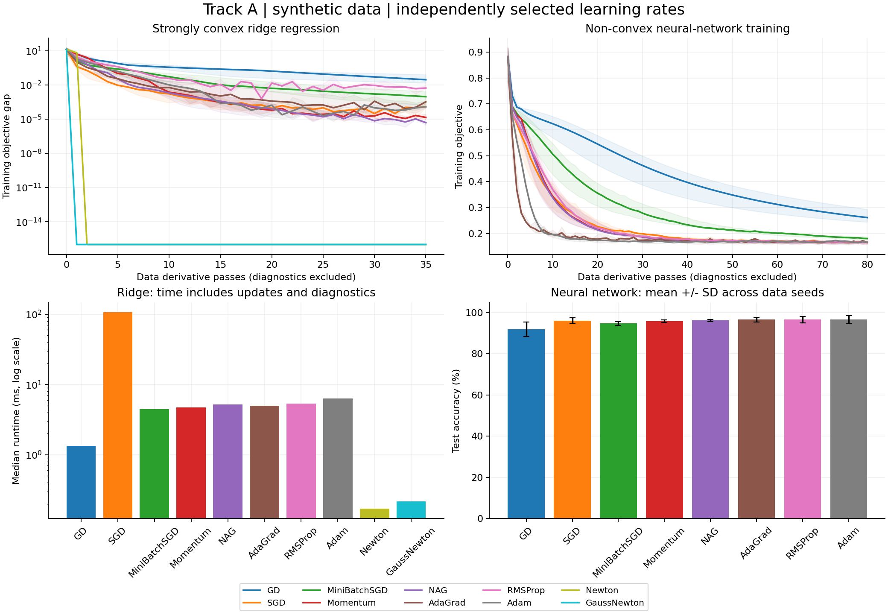
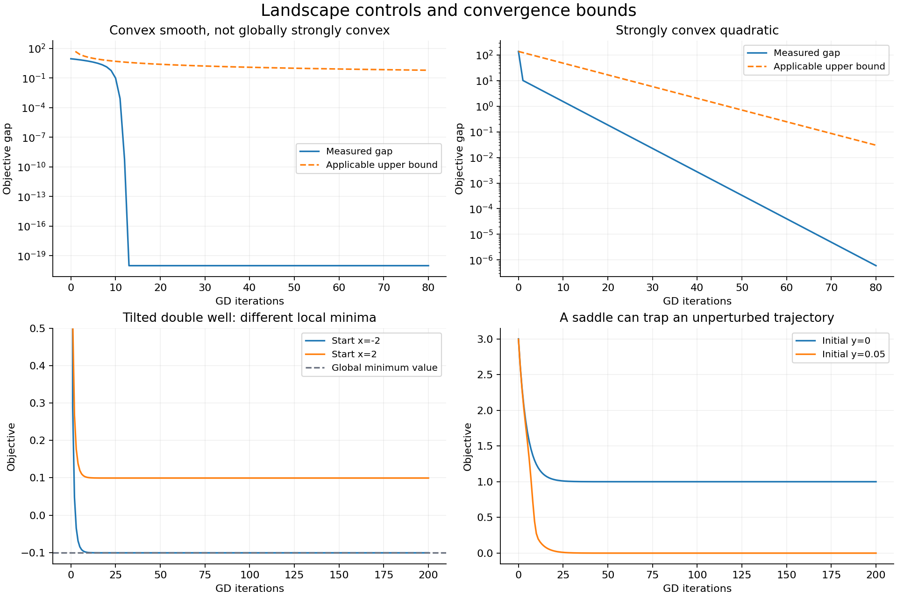
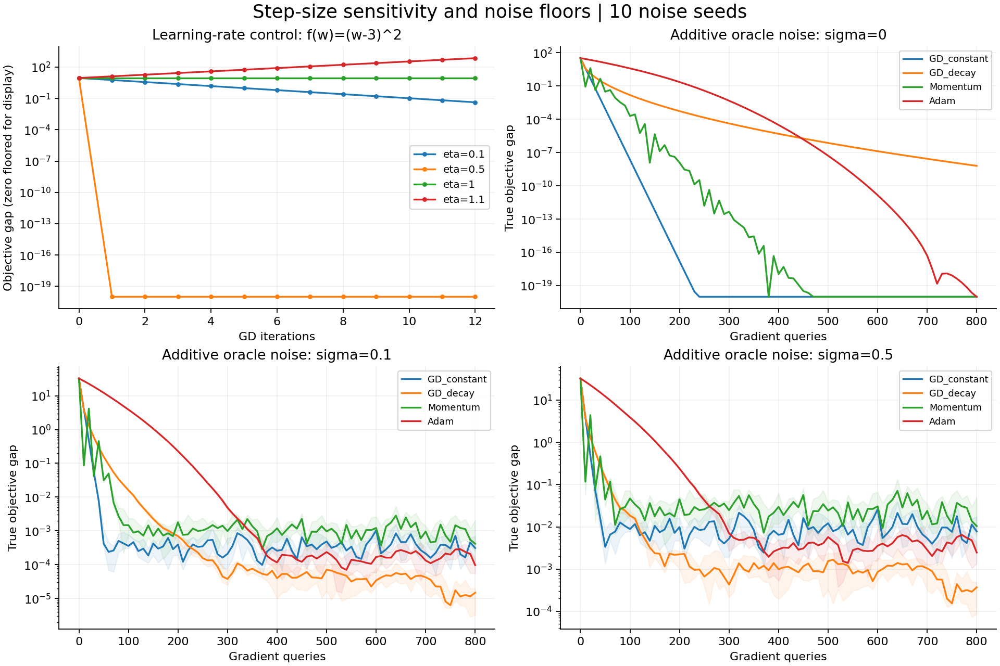
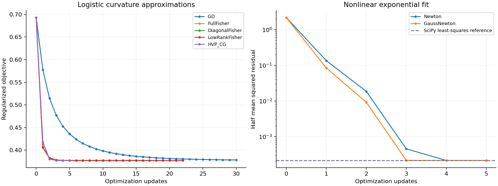

# Track A: Continuous Optimization

Measured software experiments on synthetic data. Implementations, derivatives, tuning and diagnostics are reproducible; no global-optimality claim is made for the neural network.

## Problems and mathematical formulation

Ridge regression: minimize F(w) = ||Xw-y||^2/(2n) + lambda*||w||^2/2 over unconstrained real weights. The 8-parameter problem is strongly convex with lambda=0.01. An augmented linear least-squares solution independently supplies the optimum.

Neural classification: minimize mean binary cross-entropy + 0.001*||theta||^2/2. A 2-8-1 tanh/logit network has 33 trainable parameters including biases, all regularized. Inputs and XOR labels are synthetic. Backpropagation computes the gradient; the optimizer separately chooses the update.

## Protocol and fair comparison

Training size 256, test size 256, evaluation seeds [0, 1, 2, 3, 4], timing repetitions 3. Ridge budget: 35 epochs; neural budget: 80 epochs. Full-gradient stationarity tolerance: 1e-7, checked once per epoch. There are 270 main training runs.

Each first-order method receives four candidate learning rates on separate tuning seed 999 with the same per-problem epoch budget. Candidate selection minimizes that independent tuning problem's training objective. Evaluation and test data never choose the learning rate. All 64 tuning candidates and selected settings are retained. Newton/Gauss-Newton use prescribed curvature safeguarding and Armijo backtracking, not an extra tuning search.

GD uses the full training set per update, SGD one shuffled sample, and mini-batch SGD/Momentum/NAG/AdaGrad/RMSProp/Adam up to 32 shuffled samples. One first-order epoch evaluates n sample gradients, but methods perform different numbers of updates. Newton also computes a full Hessian; Gauss-Newton computes full residuals/Jacobians. These are not equal-FLOP budgets. Update counts, derivative work and runtime must be considered together.

The same data and initial weights are used across methods for each seed; stochastic permutations are reproducible. Method order is shuffled deterministically for timing. Imports, data generation, tuning and independent audits are outside the main timer; epoch diagnostics are inside. CPU/numerical-library threading is not controlled. Runtime summaries are medians over per-seed median timing repeats. Quality uses repeat 0, never the best repeat.

## Main results

| Problem | Method | Chosen rate | Usable seeds | Mean objective +/- SD | Mean gap to ridge optimum | Mean test accuracy | Median ms |
|---|---|---:|---:|---:|---:|---:|---:|
| ridge | GD | 0.08 | 5/5 | 0.0805277 +/- 0.0542014 | 0.044312 | n/a | 1.329 |
| ridge | SGD | 0.003 | 5/5 | 0.0363784 +/- 0.0196585 | 0.000162672 | n/a | 107.602 |
| ridge | MiniBatchSGD | 0.03 | 5/5 | 0.0380889 +/- 0.0202562 | 0.00187318 | n/a | 4.477 |
| ridge | Momentum | 0.008 | 5/5 | 0.0362374 +/- 0.0196031 | 2.17631e-05 | n/a | 4.696 |
| ridge | NAG | 0.008 | 5/5 | 0.0362217 +/- 0.0196131 | 6.06894e-06 | n/a | 5.226 |
| ridge | AdaGrad | 0.8 | 5/5 | 0.0364833 +/- 0.0197249 | 0.000267632 | n/a | 4.964 |
| ridge | RMSProp | 0.03 | 5/5 | 0.0469032 +/- 0.0192465 | 0.0106875 | n/a | 5.322 |
| ridge | Adam | 0.08 | 5/5 | 0.0363365 +/- 0.0196559 | 0.000120811 | n/a | 6.328 |
| ridge | Newton | 1 | 5/5 | 0.0362157 +/- 0.0196138 | 0 | n/a | 0.170 |
| ridge | GaussNewton | 1 | 5/5 | 0.0362157 +/- 0.0196138 | 0 | n/a | 0.215 |
| mlp | GD | 1 | 5/5 | 0.264525 +/- 0.0333082 | n/a | 91.95% +/- 3.50 pp | 10.114 |
| mlp | SGD | 0.02 | 5/5 | 0.166286 +/- 0.00500731 | n/a | 96.09% +/- 1.41 pp | 579.855 |
| mlp | MiniBatchSGD | 0.3 | 5/5 | 0.181538 +/- 0.00542017 | n/a | 94.69% +/- 0.86 pp | 27.688 |
| mlp | Momentum | 0.08 | 5/5 | 0.164121 +/- 0.00486036 | n/a | 95.86% +/- 0.59 pp | 28.196 |
| mlp | NAG | 0.08 | 5/5 | 0.163823 +/- 0.00483725 | n/a | 96.17% +/- 0.51 pp | 29.381 |
| mlp | AdaGrad | 0.8 | 5/5 | 0.165224 +/- 0.00729351 | n/a | 96.56% +/- 1.18 pp | 27.866 |
| mlp | RMSProp | 0.02 | 5/5 | 0.164074 +/- 0.00645072 | n/a | 96.56% +/- 1.55 pp | 30.859 |
| mlp | Adam | 0.08 | 5/5 | 0.165489 +/- 0.00674041 | n/a | 96.56% +/- 2.06 pp | 30.267 |

Convergence curves show medians and shaded interquartile ranges across data seeds; neural accuracy bars use means and sample SD. For display only, stopped trajectories are held at their final value and near-zero ridge gaps are floored at 1e-16. The horizontal work coordinate counts sample-gradient passes plus full Hessian/Jacobian evaluations, excluding diagnostics; it is an accounting proxy, not a FLOP-equivalence claim. Raw main benchmark values are unchanged.

Ridge Newton and Gauss-Newton coincide because the residual model is linear and its J-transpose-J is the exact Hessian, including regularization. A small iteration count can still involve more work per iteration. SGD's many inexpensive updates and a full-batch GD update have different overhead. Adaptive methods can retain a residual error at a fixed rate. The neural results concern this small dataset and budget, and establish no universal optimizer ranking.

## Work and resource accounting

| Problem | Method | Mean updates | Mean derivative passes | Hessian calls | Jacobian calls |
|---|---|---:|---:|---:|---:|
| ridge | GD | 35.0 | 35.0 | 0.0 | 0.0 |
| ridge | SGD | 8960.0 | 35.0 | 0.0 | 0.0 |
| ridge | MiniBatchSGD | 280.0 | 35.0 | 0.0 | 0.0 |
| ridge | Momentum | 280.0 | 35.0 | 0.0 | 0.0 |
| ridge | NAG | 280.0 | 35.0 | 0.0 | 0.0 |
| ridge | AdaGrad | 280.0 | 35.0 | 0.0 | 0.0 |
| ridge | RMSProp | 280.0 | 35.0 | 0.0 | 0.0 |
| ridge | Adam | 280.0 | 35.0 | 0.0 | 0.0 |
| ridge | Newton | 1.0 | 2.0 | 1.0 | 0.0 |
| ridge | GaussNewton | 1.0 | 1.0 | 0.0 | 1.0 |
| mlp | GD | 80.0 | 80.0 | 0.0 | 0.0 |
| mlp | SGD | 20480.0 | 80.0 | 0.0 | 0.0 |
| mlp | MiniBatchSGD | 640.0 | 80.0 | 0.0 | 0.0 |
| mlp | Momentum | 640.0 | 80.0 | 0.0 | 0.0 |
| mlp | NAG | 640.0 | 80.0 | 0.0 | 0.0 |
| mlp | AdaGrad | 640.0 | 80.0 | 0.0 | 0.0 |
| mlp | RMSProp | 640.0 | 80.0 | 0.0 | 0.0 |
| mlp | Adam | 640.0 | 80.0 | 0.0 | 0.0 |

An explicit dense d-by-d Hessian uses d^2 numbers; a diagonal approximation d; a rank-k representation O(d*k) plus a diagonal floor. The small low-rank demonstration constructs a full Hessian and eigendecomposes it, so it does not demonstrate a memory-saving implementation. The matrix-free HVP/CG path avoids materializing a Hessian during its updates. Measured peak resident memory is not reported; only structural storage counts are claimed.

## Backpropagation and derivative verification

The hand-coded chain rule differentiates the output logit, the tanh activation, and the input/hidden/output parameters. The derivative is tested for every one of the 33 parameters against central finite differences, both on full data and a mini-batch. Each main run independently recomputes final objective and gradient norm and compares its final gradient with numerical differentiation. Relative-error normalization uses max(1, norm(analytic), norm(numeric)).

Largest final-gradient check error across main runs: 1.759e-11. Test cases also verify the explicit first and second optimizer updates, Newton/Gauss-Newton against closed-form solutions, batch averaging, unstable steps and false result claims.

## Landscapes and convergence

The convex control f(x)=sqrt(1+x^2)-1 is globally 1-smooth and not globally strongly convex. With step 1, measured gaps are checked against ||x0-x*||^2/(2k). The strongly convex quadratic has mu=1, L=10; with step 1/L its gaps satisfy the conservative geometric bound f0*(1-mu/L)^k. These experiments check valid upper bounds, not exact asymptotic-rate estimates.

A tilted double well, f(x)=(x^2-1)^2+0.1x, has two unequal local minima. Cubic derivative roots and Hessian signs identify them; GD from opposite starts reaches different minima. The bounded-below saddle example f(x,y)=0.5*x^2+(y^2-1)^2 has Hessian eigenvalues -4 and +1 at the origin. A trajectory with y=0 approaches the saddle; a perturbed y escapes. A zero gradient alone does not establish a minimum.

The neural loss is non-convex. Full-gradient stationarity would not prove a global minimum. Smoothness/step-size assumptions supporting the convex controls are not automatically imposed on the neural model or transferred to Adam/noisy updates.

## Step-size sensitivity and noisy objectives

For (w-3)^2, error is multiplied by 1-2*eta. The recorded rates 0.1, 0.5, 1 and 1.1 show contraction, a one-step solution, oscillation and divergence. A separate noisy oracle adds zero-mean Gaussian gradient and value noise to a known quadratic. Each method sees the same seeded noise stream; true costs are available only because this control is synthetic. Ten seeds and sigma 0/0.1/0.5 show variability and residual noise floors. Noise curves display medians and interquartile ranges; the table reports means and sample SD. Learning rates are prescribed controls rather than a second tuned optimizer contest.

| Noise sigma | Method | Final true gap mean | SD across noise seeds |
|---|---|---:|---:|
| 0 | GD_constant | 7.88861e-31 | 0 |
| 0 | GD_decay | 6.35085e-09 | 0 |
| 0 | Momentum | 2.46519e-32 | 0 |
| 0 | Adam | 6.4512e-21 | 0 |
| 0.1 | GD_constant | 0.00042253 | 0.000378693 |
| 0.1 | GD_decay | 2.24986e-05 | 3.488e-05 |
| 0.1 | Momentum | 0.00147154 | 0.00193377 |
| 0.1 | Adam | 0.000189243 | 0.000265187 |
| 0.5 | GD_constant | 0.0105632 | 0.00946733 |
| 0.5 | GD_decay | 0.000563047 | 0.000867046 |
| 0.5 | Momentum | 0.0367886 | 0.0483444 |
| 0.5 | Adam | 0.00353621 | 0.00358136 |

## Curvature, Fisher information and nonlinear fitting

Binary logistic regression's conditional model Fisher is X-transpose diag(p*(1-p)) X/n, equal to its unregularized cross-entropy Hessian. The empirical Fisher formed from observed-label per-example gradients generally differs. L2 curvature is added separately. Full, diagonal and rank-2 curvature approximations drive actual safeguarded updates; a matrix-free Hessian-vector product is used by conjugate gradient and checked against both dense multiplication and a directional finite difference.

| Check | Normalized error / difference |
|---|---:|
| hessian_fd_error | 2.145e-11 |
| hvp_dense_error | 1.755e-16 |
| hvp_fd_error | 7.355e-11 |
| expected_fisher_hessian_error | 0.000e+00 |
| empirical_expected_fisher_difference | 2.145e-01 |
| diagonal_relative_matrix_error | 9.873e-02 |
| low_rank_relative_matrix_error | 5.142e-02 |

For the nonlinear model a*exp(b*x), the exact Hessian contains residual-weighted second derivatives that Gauss-Newton omits. Both safeguarded implementations are compared with an independently called SciPy least_squares reference using the same residual definition and starting point. This reference is a local least-squares solution, not a proof of global optimality.

| Fit method | Objective | Difference from reference | Status |
|---|---:|---:|---|
| Newton | 0.00021326059 | 2.297e-15 | stationary |
| GaussNewton | 0.00021326059 | -6.776e-19 | stationary |

A separate library L-BFGS-B experiment, with no finite bounds, reaches a ridge objective gap of 5.565e-15. It has its own line-search/evaluation budget and is not mixed into the main equal-epoch comparison. This is a library demonstration of the limited-memory quasi-Newton method mentioned in the strategy slides.

## Loss functions, regularization and corrected slide example

MSE, cross-entropy and hinge losses have independently evaluated examples in supplementary.json. L0 counts nonzero parameters; L1 soft-thresholding can set a coefficient to zero; the L2 penalty trades fit against weight norm. Ridge uses half-MSE consistently, including its gradient and Gauss-Newton residual scaling.

| L2 strength | Weight norm | Train MSE | Test MSE |
|---|---:|---:|---:|
| 0 | 1.3492 | 0.00274379 | 0.00265892 |
| 0.01 | 1.3304 | 0.00299295 | 0.00315625 |
| 0.1 | 1.19508 | 0.0205106 | 0.0228598 |
| 1 | 0.770835 | 0.341276 | 0.368917 |

PPT1 slide 10 correction: at w=0 on samples (1,2),(2,2), the stated half-MSE loss gives gradient [(-2)*1+(-2)*2]/2 = -3, so eta=0.1 gives w1=0.3. The slide's -5 and 0.5 do not match its stated data. The least-squares optimum remains 6/5=1.2. This independently verified source arithmetic issue is not represented as a fabricated AI-code failure.

## Limitations and assignment status

Results use small synthetic problems, one independent tuning instance per family, finite hyperparameter grids and a fixed compute environment. They do not establish a general ranking or large-model scalability. There is no real-data benchmark or global neural optimum. Memory complexity is described rather than measured with a peak-memory profiler. Timing includes Python/diagnostic overhead and library threading is uncontrolled. Longer training or different settings can change the outcomes.

This package implements the core Track A requirements and the additional L-BFGS demonstration. Research spotlights such as GRNG and AdaFisher are explicitly listed as pending literature/reproduction items in the coverage checklist; they are not claimed as implemented. The assignment-wide second AI-tool comparison, genuine failure log, full chat exports, remaining tracks and public GitHub publication remain outstanding.

## Environment and sources

Recorded UTC: 2026-10-31T18:15:16.529655+00:00; Python: 3.12.14 (main, Aug 25 2026, 14:00:49) [Clang 22.1.3 ]; NumPy 2.3.5; SciPy 1.17.0.
CPU: AMD EPYC 9V74 80-Core Processor; logical/affinity CPUs: 9/9; cpu.max: 800000 100000. Sequential CPU experiments, no GPU, numerical-library threading not explicitly controlled.

Sources: supplied Assignment 8 Track A/Section 5; Chapter 6 PPT1 and PPT4. Adam: Kingma and Ba, https://arxiv.org/abs/1412.6980. Backpropagation: Goodfellow, Bengio and Courville, https://www.deeplearningbook.org/contents/mlp.html. Library references: https://docs.scipy.org/doc/scipy/reference/generated/scipy.optimize.least_squares.html and https://docs.scipy.org/doc/scipy/reference/optimize.minimize-lbfgsb.html. Public references accessed 2026-10-31. Installed versions are recorded above.
