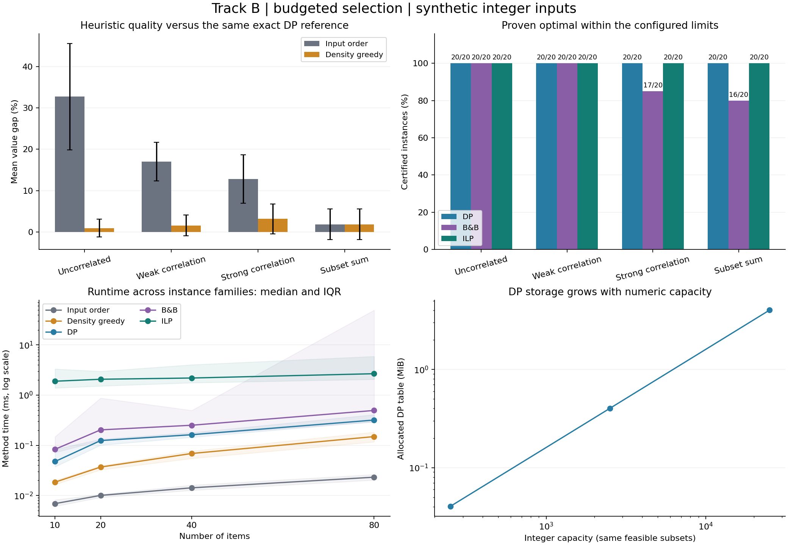
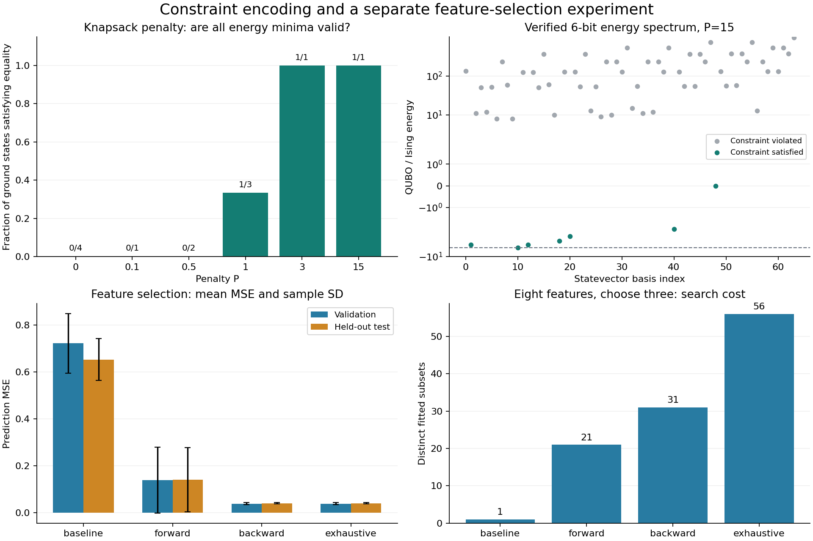

# Track B: Discrete Optimization

Measured classical software experiments on synthetic selection problems. Quantum hardware and QAOA are not used in this track; exact QUBO/Ising references are exported for Track C.

## Problem and formulation

Choose binary item decisions x_i to maximize sum(value_i*x_i), subject to sum(weight_i*x_i) <= capacity. Values are nonnegative integers; costs are positive integers. The empty selection is always feasible, including when no item fits. A separate feature-selection experiment minimizes validation MSE subject to exactly three of eight features.

The baseline considers items in input order and takes each one if it fits. Density greedy sorts by decreasing value/cost using exact integer cross-products. Neither heuristic has an optimality guarantee in this implementation. Dynamic programming, a custom Branch-and-Bound and a library binary ILP solve the same knapsack formulation.

## Experimental protocol

80 main instances: four synthetic families, sizes [10, 20, 40, 80], seeds [0, 1, 2, 3, 4], plus five diagnostic cases. Each method is measured 3 times, giving 1275 main/control method runs. Quality summaries use repetition 0; timing uses medians of per-instance median repetitions. Every candidate is independently checked for binary decisions, budget and objective value.

Branch-and-Bound uses a 2.0 s limit and 100,000 expanded-node limit. ILP has the same time limit and a zero relative MIP-gap target. DP has a 10,000,000-cell allocation guard. The generated workloads fit within that guard, allowing an exact DP reference on every case. Search methods may return a feasible candidate without completing a proof.

Method order is deterministically shuffled. Timing includes validation, model construction and solver execution, but excludes reference generation, independent auditing, plots and imports. One tiny ILP call warms up the library. All data and stopping rules are recorded. No measured parallel speedup is claimed and internal numerical-library threading is uncontrolled.

## Results: quality and computation

| Family | Method | Feasible | Proven optimal | Matches DP optimum | Value gap mean +/- SD | Median ms |
|---|---|---:|---:|---:|---:|---:|
| Uncorrelated | Input order | 20/20 | 0/20 | 0/20 | 32.7164% +/- 12.8653 pp | 0.0119 |
| Uncorrelated | Density greedy | 20/20 | 0/20 | 7/20 | 0.9705% +/- 2.1622 pp | 0.0516 |
| Uncorrelated | DP | 20/20 | 20/20 | 20/20 | 0.0000% +/- 0.0000 pp | 0.1401 |
| Uncorrelated | B&B | 20/20 | 20/20 | 20/20 | 0.0000% +/- 0.0000 pp | 0.1855 |
| Uncorrelated | ILP | 20/20 | 20/20 | 20/20 | 0.0000% +/- 0.0000 pp | 2.1210 |
| Weak correlation | Input order | 20/20 | 0/20 | 0/20 | 17.0431% +/- 4.6421 pp | 0.0123 |
| Weak correlation | Density greedy | 20/20 | 0/20 | 8/20 | 1.5733% +/- 2.5135 pp | 0.0530 |
| Weak correlation | DP | 20/20 | 20/20 | 20/20 | 0.0000% +/- 0.0000 pp | 0.1314 |
| Weak correlation | B&B | 20/20 | 20/20 | 20/20 | 0.0000% +/- 0.0000 pp | 0.1510 |
| Weak correlation | ILP | 20/20 | 20/20 | 20/20 | 0.0000% +/- 0.0000 pp | 2.4329 |
| Strong correlation | Input order | 20/20 | 0/20 | 0/20 | 12.8141% +/- 5.8793 pp | 0.0122 |
| Strong correlation | Density greedy | 20/20 | 0/20 | 1/20 | 3.1848% +/- 3.6226 pp | 0.0688 |
| Strong correlation | DP | 20/20 | 20/20 | 20/20 | 0.0000% +/- 0.0000 pp | 0.1648 |
| Strong correlation | B&B | 20/20 | 17/20 | 17/20 | 0.0652% +/- 0.1629 pp | 0.5665 |
| Strong correlation | ILP | 20/20 | 20/20 | 20/20 | 0.0000% +/- 0.0000 pp | 3.2027 |
| Subset sum | Input order | 20/20 | 0/20 | 7/20 | 1.8638% +/- 3.6871 pp | 0.0106 |
| Subset sum | Density greedy | 20/20 | 0/20 | 7/20 | 1.8638% +/- 3.6871 pp | 0.0295 |
| Subset sum | DP | 20/20 | 20/20 | 20/20 | 0.0000% +/- 0.0000 pp | 0.1241 |
| Subset sum | B&B | 20/20 | 16/20 | 16/20 | 0.0439% +/- 0.0937 pp | 0.3203 |
| Subset sum | ILP | 20/20 | 20/20 | 20/20 | 0.0000% +/- 0.0000 pp | 1.6079 |

Gap is 100*(DP optimum - candidate value)/DP optimum, with zero when both are zero. A heuristic matching the known optimum is different from that heuristic proving optimality. Quality uses feasible returned candidates; all failures/limit statuses remain in raw_runs.json. Error bars describe dataset variability, not confidence intervals.

Density greedy is generally much better than the input-order baseline on these generated families, yet can miss the optimum. Equal value/weight ratios make tie handling relevant: the subset-sum family intentionally gives greedy the same order as the baseline. DP is effective at these integer capacities. Search methods trade proof effort against time/node limits; small nonzero gaps remain meaningful outcomes. These results do not establish a universal method ranking.

## Diagnostic cases

| Case | Method | Value | Used budget | Reference value | Status |
|---|---|---:|---:|---:|---|
| teaching | Input order | 5 | 3 | 6 | heuristic |
| teaching | ILP | 6 | 3 | 6 | optimal |
| teaching | B&B | 6 | 3 | 6 | optimal |
| teaching | DP | 6 | 3 | 6 | optimal |
| teaching | Density greedy | 6 | 3 | 6 | heuristic |
| greedy_trap | DP | 220 | 50 | 220 | optimal |
| greedy_trap | ILP | 220 | 50 | 220 | optimal |
| greedy_trap | B&B | 220 | 50 | 220 | optimal |
| greedy_trap | Input order | 160 | 30 | 220 | heuristic |
| greedy_trap | Density greedy | 160 | 30 | 220 | heuristic |
| no_item_fits | Input order | 0 | 0 | 0 | heuristic |
| no_item_fits | ILP | 0 | 0 | 0 | optimal |
| no_item_fits | DP | 0 | 0 | 0 | optimal |
| no_item_fits | B&B | 0 | 0 | 0 | optimal |
| no_item_fits | Density greedy | 0 | 0 | 0 | heuristic |
| zero_capacity | Density greedy | 0 | 0 | 0 | heuristic |
| zero_capacity | B&B | 0 | 0 | 0 | optimal |
| zero_capacity | DP | 0 | 0 | 0 | optimal |
| zero_capacity | ILP | 0 | 0 | 0 | optimal |
| zero_capacity | Input order | 0 | 0 | 0 | heuristic |
| empty | ILP | 0 | 0 | 0 | optimal |
| empty | Input order | 0 | 0 | 0 | heuristic |
| empty | Density greedy | 0 | 0 | 0 | heuristic |
| empty | DP | 0 | 0 | 0 | optimal |
| empty | B&B | 0 | 0 | 0 | optimal |

The three-item greedy trap has values (60,100,120), costs (10,20,30), capacity 50. Density greedy selects the first two for value 160; selecting the last two gives 220. This is a deliberate heuristic counterexample, not an AI implementation defect. Empty/zero-capacity/no-fit cases correctly allow selecting nothing.

## Exact methods and storage

DP stores the recurrence D[i,c] = max(D[i-1,c], value_i + D[i-1,c-weight_i]) when item i fits. The previous row prevents reusing an item. Backtracking produces a binary selection. Time and full-table storage are O(n*C), pseudo-polynomial in numeric capacity rather than polynomial in its bit length.

Branch-and-Bound explores include/exclude decisions with a feasible density-greedy incumbent. A fractional-knapsack relaxation bounds remaining profit. The bound uses exact ratio ordering and integer arithmetic; flooring is valid because attainable total values are integers. Only nodes with an upper bound above the incumbent remain relevant. A nonempty unresolved frontier leaves an explicit proof gap.

ILP minimizes the negative total value using SciPy/HiGHS with bounds 0..1, integer variables and a single capacity inequality. The solver is acknowledged as external. Claimed optima are cross-checked against DP; smaller random cases are independently enumerated without DP tables or solver matrices.

| Capacity multiplier | Capacity | DP table cells | Table MiB | Median DP ms | Value |
|---|---:|---:|---:|---:|---:|
| 1 | 251 | 5292 | 0.0404 | 0.0623 | 522 |
| 10 | 2510 | 52731 | 0.4023 | 0.1080 | 522 |
| 100 | 25100 | 527121 | 4.0216 | 0.7964 | 522 |

Multiplying weights and capacity changes integer units while preserving feasible subsets. This exposes capacity dependence, but GCD preprocessing would remove this particular inflation. It is a controlled illustration, not an inherent hardness claim about the rescaled instance. Table bytes are measured from the allocated array; overall process peak memory is not reported.

## QUBO with explicit constraint penalties

For the four-item teaching case, introduce nonnegative slack s=b0+2*b1 and encode E(x,b) = -sum(v_i*x_i) + P*(sum(w_i*x_i)+s-C)^2. The six binary variables comprise four items and two slack bits. All feasible original selections have representable slack; overweight selections cannot satisfy the equality.

Writing z for all item/slack bits, a for their costs/slack weights and v_bar for rewards padded with zeros: Q_ii = P*(a_i^2-2*C*a_i)-v_bar_i, Q_ij=2*P*a_i*a_j for i<j, offset=P*C^2. Q is upper triangular and each off-diagonal pair is counted once. The constant offset is retained in every comparison.

A sufficient penalty is P > sum(values). Any equality violation has integer residual magnitude at least one, hence energy at least P-sum(values)>0, while a feasible empty item selection has energy zero. Therefore every global energy minimum is feasible, and within feasible states energy is negative selected value. The chosen P=15 satisfies this sufficient condition; smaller penalties can work for this particular case without meeting the general bound.

| Penalty | Minimum energy | Ground states | Equality-valid ground states | Original-budget-valid ground states |
|---|---:|---:|---:|---:|
| 0 | -14 | 4 | 0 | 0 |
| 0.1 | -11.5 | 1 | 0 | 0 |
| 0.5 | -7 | 2 | 0 | 0 |
| 1 | -6 | 3 | 1 | 1 |
| 3 | -6 | 1 | 1 | 1 |
| 15 | -6 | 1 | 1 | 1 |

Too small a penalty can change the problem or create invalid ties. The experiment checks all minimizing states rather than accepting the first minimum that happens to be feasible. Large penalties increase coefficient scales and may complicate later quantum sampling; no hardware advantage is claimed. The encoder rejects total absolute coefficient magnitude above 2^45 to avoid known unsafe floating-point ranges.

## Ising conversion and Track C handoff

The spin convention is s_i=1-2*z_i. For upper-triangular Q, h_i=-Q_ii/2 - sum_(j!=i) Q_min(i,j),max(i,j)/4; J_ij=Q_ij/4 for i<j; Ising offset=QUBO offset+sum_i Q_ii/2+sum_(i<j) Q_ij/4. Every exported bitstring is checked against the direct objective, expanded QUBO and Ising energy.

| Model | Bits | Enumerated states | Minimum energy | Ground states | Max energy identity error |
|---|---:|---:|---:|---:|---:|
| knapsack_6bit | 6 | 64 | -6 | 1 | 0.000e+00 |
| maxcut_4bit | 4 | 16 | -4 | 2 | 0.000e+00 |

The four-node Max-Cut graph has edges (0,1),(1,2),(2,3),(3,0),(0,2), all weight one. Its unconstrained QUBO minimizes negative cut. Diagonal Q entries are negative weighted degrees, edge pair entries are twice edge weight; minimum energy -4 means cut value 4. The constrained knapsack case independently supplies the required penalty demonstration.

The quantum_baselines folder contains model coefficients, offsets, variable names, every classical state energy, every ground state and checksums. Basis index is sum(z_i*2^i), with variable 0 least significant. variable_order_bits lists z0 first, while statevector_label prints the most significant bit first. A later simulator must preserve this mapping and restore any positive energy rescaling before comparing objective values.

## Forward/backward feature selection

A separate synthetic regression task has eight candidate features and three selected features. Each candidate least-squares model is fit using 128 training samples. Validation MSE on 128 separate samples determines the subset; test MSE on 256 held-out samples is evaluated only after selection. Exhaustive selection considers all 56 three-feature subsets. Forward selection adds features; backward elimination starts with all features and removes them.

| Method | Mean validation MSE | Mean test MSE | Distinct model fits |
|---|---:|---:|---:|
| baseline | 0.72133 | 0.652013 | 1 |
| forward | 0.138586 | 0.140929 | 21 |
| backward | 0.0385656 | 0.04042 | 31 |
| exhaustive | 0.0385656 | 0.04042 | 56 |

Arbitrary validation performance is not assumed additive, monotone or submodular. No 1-1/e guarantee is claimed for this feature objective. The knapsack ILP is not misrepresented as a linear formulation of black-box validation error. Exhaustive validation optimality also does not guarantee the lowest unseen test error.

## Correctness, failures and limitations

Tests compare DP, Branch-and-Bound and ILP with exhaustive enumeration on 100 random small instances, and verify the constrained QUBO optimum on 20 random tiny knapsacks. Adversarial checks include fractional candidates, capacity violations, single-use DP recurrence, exact-ratio sorting, resource guards, weak penalties, bit ordering, energy offsets and feature test-data isolation. Every recorded main candidate is independently audited.

A genuine AI-generated numerical defect was found before the benchmark: a huge-capacity knapsack expanded in float coefficients gave energy 0 for a state whose direct energy is -1. A conservative coefficient-range guard now rejects that unsafe mapping, with a regression test. Original code and correction are retained in git history. Designed heuristic failures and configured search limits are not counted as implementation bugs.

Limitations: synthetic additive values/costs, single budget, small feature dimension, integer DP capacities, fixed search budgets, and classical enumeration limited to tiny QUBOs. These tests do not establish scalability to arbitrary large instances, real application gains or quantum advantage. Full assignment integration, remaining tracks, the second AI-tool comparison and public GitHub publication remain pending.

## Environment and references

UTC 2026-11-03T05:53:06.191845+00:00; Python 3.12.14 (main, Aug 25 2026, 14:00:49) [Clang 22.1.3 ]; NumPy 2.3.5; SciPy 1.17.0.
CPU AMD EPYC 9V74 80-Core Processor; logical/affinity CPUs 9/9; cpu.max 800000 100000. Sequential CPU runs; numerical-library/HiGHS threading not explicitly fixed. No GPU or quantum hardware used.

Sources: supplied Assignment 8 Track B/Section 5 and Chapter 6 PPT1/PPT3. SciPy milp documentation: https://docs.scipy.org/doc/scipy/reference/generated/scipy.optimize.milp.html. D-Wave QUBO/Ising conventions: https://docs.dwavequantum.com/en/latest/quantum_research/qubo_ising.html (the spin sign convention used here is stated explicitly). Google OR-Tools knapsack description: https://developers.google.com/optimization/pack/knapsack; OR-Tools itself is not used in this code. Public references accessed 2026-11-03.
