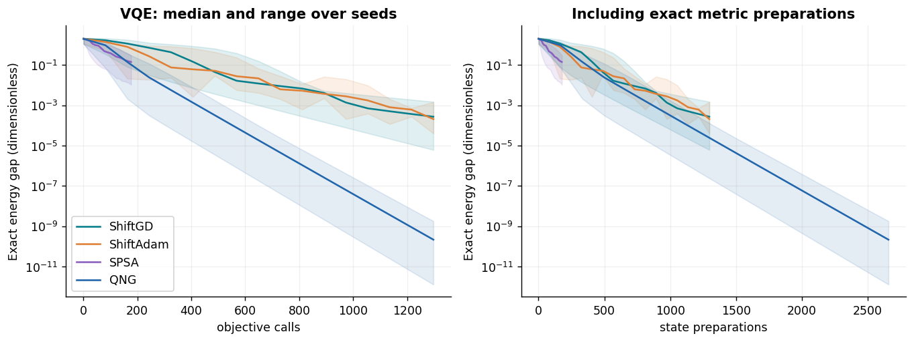
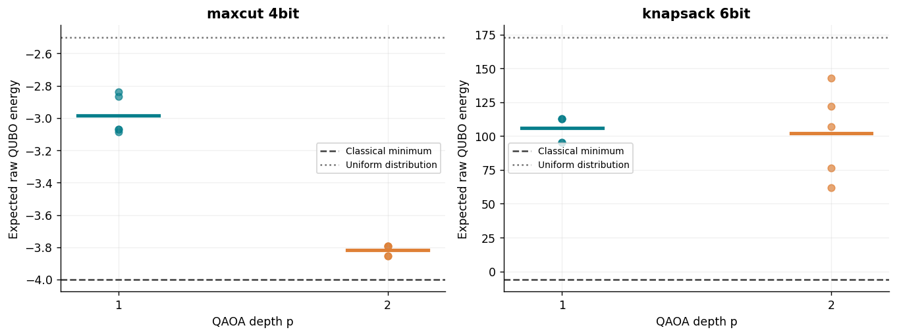
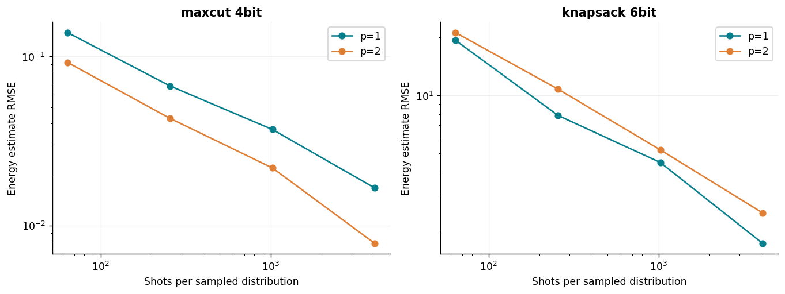
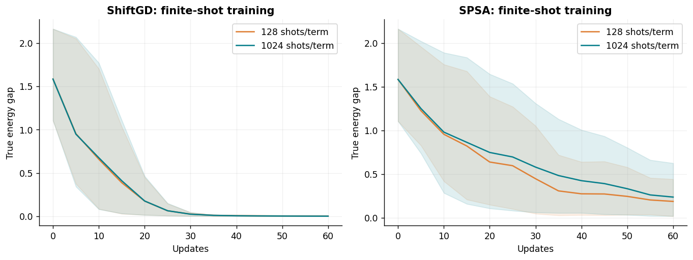
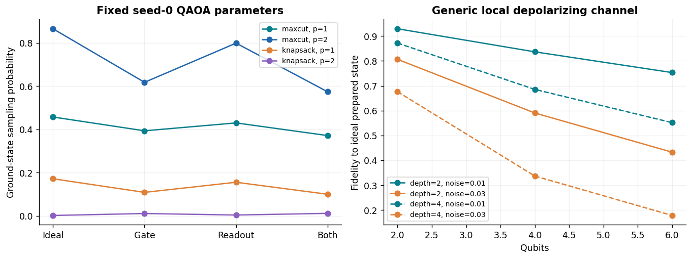
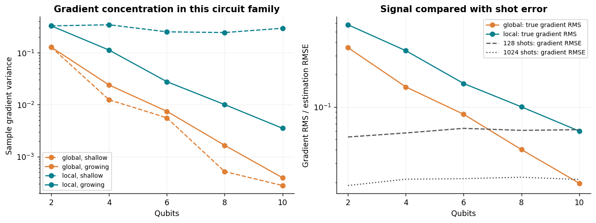
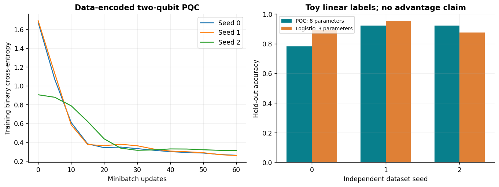

# Track C: Quantum Optimization

Simulator experiments for Assignment 8. All quantities below come from the retained JSON records. No physical quantum computer or calibrated device was used. This package uses an authored NumPy simulator, checked against independent dense-matrix calculations.

The main findings are conditional on tiny synthetic problems, fixed optimizer settings and the recorded seeds. Classical exact methods already solve these examples cheaply; there is no speedup or quantum-advantage claim.

# Protocol and scope

| Experiment | Recorded work |
| --- | --- |
| Ideal VQE | 20 runs; four methods; 5 seeds; 80 updates |
| QAOA | 20 runs; two unchanged Track B QUBOs; p=1,2; all seeds |
| Born sampling | 1,600 distributions; 4 shot budgets; 100 repeats/configuration |
| Finite-shot training | 12 runs; ShiftGD and SPSA; 128/1,024 shots per Pauli term |
| Noise | 20 fixed-parameter cases + 18 size/depth controls |
| PQC classifier | 3 datasets; 24 train and 64 test observations each |
| Gradient concentration | 20 summaries; 64 random parameters each; 2–10 qubits |

Main VQE comparisons use the same initialization and update count, with unequal evaluation costs shown explicitly. Seed 0 was designated for post-training shots/noise before inspecting results. QAOA uses local Powell search; the objective-call cap is recorded in protocol.json and is not a ground-state certificate. Exact objectives use zero physical or sampled measurement shots.

Source arrays, parameters, distributions, individual samples, optimizer status and CPU timings are retained. Statevector memory scales as 2^n; density matrices as 4^n.

# VQE and optimizer cost

The synthetic Hamiltonian is H = 0.7 Z0 + 0.3 Z1 + 0.6 X0X1 − 0.2 Z0Z1. Its exact classical ground energy is **-1.366190378969**, in dimensionless units. This is not a molecular H2 calculation.

| Method | Mean final gap | Largest final gap | Objective calls/run | State preparations/run | Metric subset | Mean CPU seconds |
| --- | --- | --- | --- | --- | --- | --- |
| ShiftGD | 0.000433 | 0.00149 | 1297 | 1297 | 0 | 0.2225 |
| ShiftAdam | 0.000416 | 0.00145 | 1297 | 1297 | 0 | 0.2282 |
| SPSA | 0.145 | 0.297 | 177 | 177 | 0 | 0.0350 |
| QNG | 5.91e-10 | 1.79e-09 | 1297 | 2657 | 1360 | 0.4041 |

Lines show medians; shading shows the full seed range. Gaps below 1e-12 are clipped only for the logarithmic display.

QNG uses the full Fubini–Study metric from exact simulator amplitudes, with damping 1e-3 and update norm capped at 1. Metric evaluations are included in state preparations. That access is a simulator convenience, not a hardware measurement implementation. SPSA uses two objective evaluations per update; its weaker result at the same number of updates must be considered alongside its smaller budget. Hyperparameters were fixed, not equally tuned.

# QAOA on unchanged Track B objectives

| Model | p | Mean energy | Exact minimum | Mean ground probability | Original feasible | Encoded feasible | Local convergence |
| --- | --- | --- | --- | --- | --- | --- | --- |
| maxcut_4bit | 1 | -2.98554 | -4.0 | 38.96% | 100.00% | 100.00% | 5/5 |
| maxcut_4bit | 2 | -3.81792 | -4.0 | 86.42% | 100.00% | 100.00% | 5/5 |
| knapsack_6bit | 1 | 105.92374 | -6.0 | 12.26% | 53.54% | 16.67% | 5/5 |
| knapsack_6bit | 2 | 101.97741 | -6.0 | 3.13% | 63.17% | 14.00% | 5/5 |

Dots are individual seeds; short horizontal bars are means. Raw QUBO penalties retain their original scale.

Max-Cut improved at p=2 in these runs. Constrained knapsack remains far from its ground energy; extra depth does not ensure improvement under a difficult periodic local search. The original capacity constraint and exact slack equality have different feasibility probabilities. An original-feasible sample with incorrect slack can still have a high penalized energy. Finding a good sampled bitstring does not imply a good expected energy. All optimizer outcomes, including poor ones, remain in the data.

The mixer is exp(−i β ΣX); the cost unitary is exp(−i γ E). Gate decomposition omits only the global phase from the constant offset; every reported energy includes that offset. Shared QAOA angles control multiple gates, so the simple two-point single-gate parameter-shift formula is not applied to them.

# Classical references and resources

| Model | Classical method | Exact energy | Median CPU seconds | Quantum-method CPU simulation |
| --- | --- | --- | --- | --- |
| maxcut_4bit | exhaustive binary enumeration | -4.0 | 0.000045 | p=1: 0.0109s / 81 calls, p=2: 0.0750s / 426 calls |
| knapsack_6bit | exhaustive binary enumeration | -6.0 | 0.000188 | p=1: 0.0167s / 107 calls, p=2: 0.0887s / 366 calls |
| vqe_2qubit | dense Hermitian eigensolve | -1.36619037896906 | 0.000087 | See VQE cost table |

Classical timings use 31 repeats after one warmup, excluding input I/O. They are tiny-problem demonstrations rather than robust performance rankings. QAOA here stores all 2^n diagonal energies classically before optimization; this exponential simulation work is not a quantum oracle implementation. Primitive gates and CNOT counts per prepared QAOA circuit are in qaoa_runs.json. No timing includes hardware queueing, physical gates, coherence limits or device measurement latency.

# Finite shots and stochastic training

Energy RMSE uses 100 independent multinomial samples at each budget, from each fixed seed-0 distribution.

Training plots use independent ideal diagnostics at retained iterates, not the noisy energy estimate used for each update. Shading is the seed range.

Each finite-shot VQE objective estimates four Pauli terms independently; S shots/term means 4S total shots per objective. No commuting-term grouping is claimed. A sampled energy estimate may lie below the exact ground energy because of sampling error; the exact diagnostic must still satisfy the variational bound. Shot totals count all gradient and logged training objectives. Diagnostic state preparations are reported separately. The shot study samples cached simulator probabilities, so its CPU time is not a hardware execution estimate.

# Synthetic noise controls

Gate noise uses strength 0.01; readout uses independent 0.02 bit-flip probability. Parameters are fixed rather than reoptimized.

After each primitive gate, each involved qubit receives Dp(ρ)=(1−3p/4)ρ+(p/4)(XρX+YρY+ZρZ). A CNOT is followed by a local channel on both qubits. This convention makes p=1 complete depolarization on the affected qubit. Pauli measurement-basis rotations are ideal.

Readout changes observed probabilities but not prepared-state fidelity or purity. Noise can accidentally improve a poor heuristic distribution; it is not guaranteed to worsen every objective in every case. This is a generic synthetic channel with no device calibration, connectivity routing, correlated noise, relaxation or mitigation. Density-matrix cases stop at six qubits.

# Barren-plateau diagnostic

The derivative is with respect to the first Ry angle. Global cost is the product of all Zs; local cost is Z0. Shallow depth=2; growing depth=n.

Global-cost variance for growing depth changes from 0.1278 at n=2 to 0.0003931 at n=10. This is an empirical concentration diagnostic for one ansatz, initialization and parameter choice. It is not proof of exponential scaling or a universal barren plateau. Local and shallow controls expose dependence on the cost and circuit family.

Each exact gradient uses two shifted states. For each shift and shot budget, independent binomial outcomes estimate the ±1 observable; 20 repeated estimates are retained per parameter point. Shot RMSE can exceed the shrinking gradient signal. Sample variances use ddof=1; duplicate n=2 depth controls intentionally share the same configuration. Raw angles and shifted expectations allow recomputation.

# Trainable PQC / QNN

A two-qubit circuit encodes features with Ry(πx/2), then uses two Ry/Rz and CNOT layers. Minibatch Adam trains binary cross-entropy.

| Seed | PQC test accuracy | Logistic test accuracy | PQC state preparations | PQC CPU seconds | Logistic CPU seconds |
| --- | --- | --- | --- | --- | --- |
| 0 | 78.12% | 89.06% | 8536 | 1.2534 | 0.0042 |
| 1 | 92.19% | 95.31% | 8536 | 1.2460 | 0.0013 |
| 2 | 92.19% | 87.50% | 8536 | 1.1728 | 0.0029 |

Labels are deliberately linear: x0+0.5x1>0, from synthetic uniform features. The regularized logistic baseline has three parameters; the PQC has eight and uses a different training procedure and budget. This is a functional learning demonstration, not a capacity-matched model comparison. Training data alone supplies gradients; test data is evaluated only at the end. The circuit expectation is shifted first, then the classical nonlinear loss chain rule is applied. Shifting the entire cross-entropy with the single-gate formula would be incorrect.

# Validation and limits

The 32 unit tests cover independent dense gates and QAOA exponentials, CNOT bit order, density positivity and trace, Y-basis measurement, readout/depolarization endpoints, parameter-shift versus finite differences, Fubini–Study metric and global-phase removal, SPSA call counts, QNN loss gradients, Track B hashes and every-state energies. A separate audit recomputes retained outputs and samples.

These experiments implement the core Track C items. They do not complete the ten-track assignment. The original and fixed defects from A/B remain the two genuine AI failure cases so far; no third is invented here. A second independent AI-tool comparison, full chat exports, public GitHub publication, remaining tracks and the combined submission still need completion. See docs/COVERAGE.md and docs/VALIDATION_RECORD.md.

# Primary references

- Farhi, Goldstone & Gutmann, QAOA: https://arxiv.org/abs/1411.4028
- Peruzzo et al., VQE: https://arxiv.org/abs/1304.3061
- Schuld et al., analytic quantum gradients: https://arxiv.org/abs/1811.11184
- Stokes et al., Quantum Natural Gradient: https://arxiv.org/abs/1909.02108
- McClean et al., barren plateaus: https://arxiv.org/abs/1803.11173
- Spall, SPSA overview: https://www.jhuapl.edu/SPSA/PDF-SPSA/Spall_An_Overview.PDF
- Qiskit Aer depolarizing convention: https://qiskit.github.io/qiskit-aer/stubs/qiskit_aer.noise.depolarizing_error.html
- Supplied Assignment 8 and Chapter 6 lecture slides; acknowledged, not redistributed. Public references accessed 2026-11-03.
