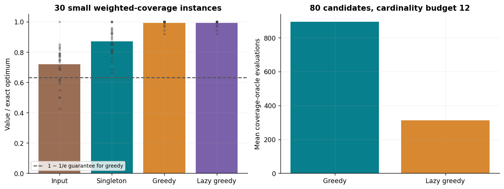
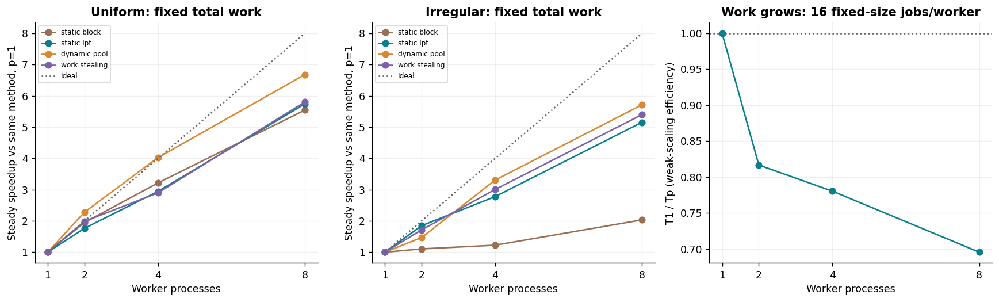
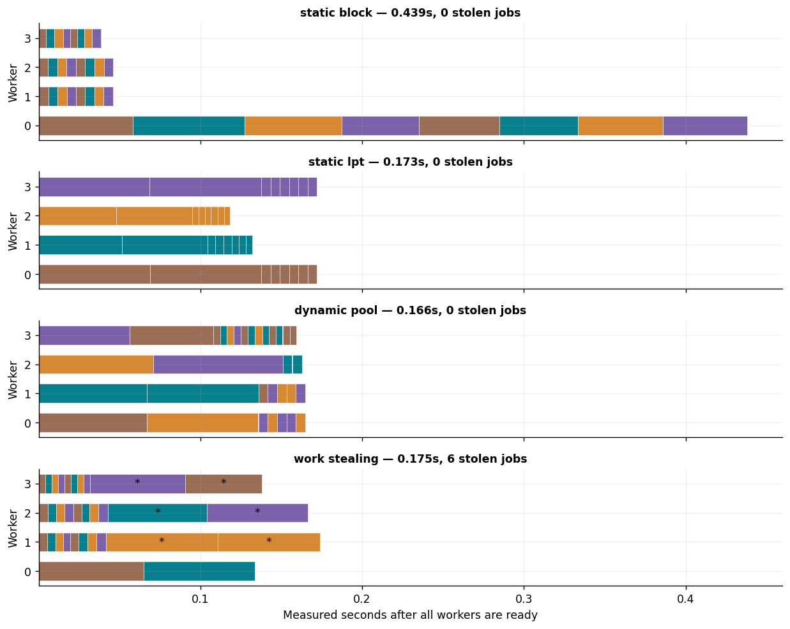
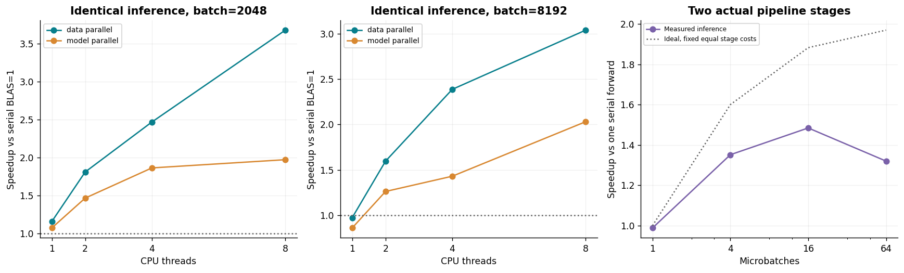
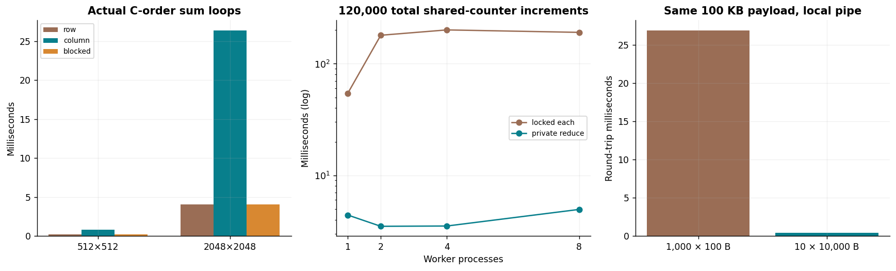
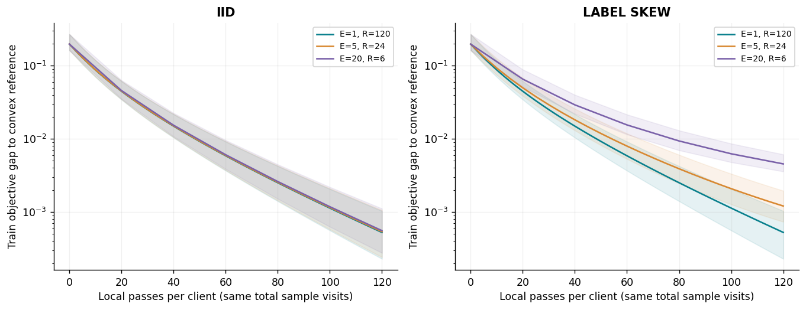
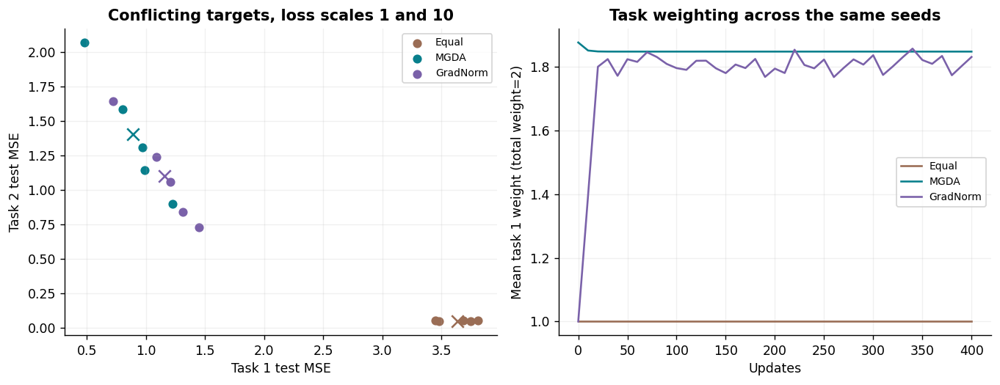

# Track D: Submodular, Parallel and Distributed Optimization

Prepared for Akshat Tikaria, roll number 241070005. Assignment 8 simulation/implementation portfolio. Actual parallel CPU measurements were taken with 9 visible logical CPUs, affinity size 9, and a cgroup CPU quota of 8 CPU equivalents. These are cloud-workspace measurements, not measurements of the student’s laptop.

Weighted coverage, real process scheduling and shared-memory inference complement serial FedAvg and multi-task learning experiments. No GPU, multi-node deployment, privacy protection or quantum speedup is claimed. All datasets are synthetic.

# Protocol and evidence

| Experiment | Retained evidence |
| --- | --- |
| Coverage | 45 instances; 210 method runs; exact enumeration on 30 small cases |
| Strong scaling | 96 actual process runs; two workload families; four schedulers; workers [1, 2, 4, 8] |
| Weak scaling | 12 runs; workload grows with workers |
| Data/model inference | 54 timings including serial references; identical outputs |
| Pipeline | 12 timings; two CPU stages; 1/4/16/64 microbatches |
| System controls | 24 synchronization, 15 local-pipe, 18 locality timings |
| Federated learning | 90 FedAvg + 35 matched centralized runs |
| Multi-task learning | 45 runs; three task families; three methods |

The protocol fixes 5 learning seeds and 3 timing repeats. Scheduling and data/model trial orders are shuffled using recorded seeds. CPU allocation is recorded; shared hardware variability remains. Steady timers start after worker readiness. End-to-end timers retain setup and cleanup. BLAS kernels use one native thread so application-level parallelism does not multiply hidden thread pools.

# Submodular weighted coverage

Bars show mean solution/optimum on small instances; dots show all cases. Oracle counts concern function evaluations, not guaranteed wall-time gains.
Maximize f(S)=sum of nonnegative weights of universe items covered by the selected candidates, with |S|≤k. This function is normalized, monotone and submodular: adding a candidate contributes only its still-uncovered items, which can only shrink as S grows. Under these cardinality assumptions, exact-marginal greedy has the 1−1/e lower bound; the finite-k bound is 1−(1−1/k)^k.

| Method | Mean exact ratio | Worst exact ratio |
| --- | --- | --- |
| input_order | 0.7188 | 0.4242 |
| singleton | 0.8702 | 0.6630 |
| greedy | 0.9930 | 0.9206 |
| lazy_greedy | 0.9930 | 0.9206 |

Lazy greedy keeps diminishing-return upper bounds in a heap and returns the same deterministic selection as ordinary greedy on all saved cases. Large n=80 cases have no exhaustive optimum claim; their upper bounds are labeled bounds. An explicit counterexample gives greedy value 5 versus optimum 6. A separate |S|² control violates diminishing returns; no submodular guarantee is claimed for that function. Exhaustive small-instance assumption checks supplement the structural proof.

# Load balancing, stealing and scaling

Each strong-scaling curve uses its own scheduler’s one-worker median. Weak efficiency uses fixed work per worker and must not be read as fixed-problem speedup.

Actual irregular-job traces, p=4, repeat 0. An asterisk marks a job taken from another worker’s pending deque.
Each family has the same 32 jobs at every strong-scaling worker count. The deterministic PBKDF2 kernel returns a checked digest for each job; there are no sleep-based timings. Irregular jobs put eight heavy jobs first, exposing poor contiguous static assignment. LPT greedily places the largest remaining predicted job on the least-loaded worker. The central task pool and decentralized deque stealing are implemented separately. Stealing moves only unstarted jobs and releases locks before computing. The shared-array backend uses local memory and synchronization, not sockets.

| Family | Method | p=8 steady s | End-to-end s | Steady speedup | Efficiency | Mean stolen jobs |
| --- | --- | --- | --- | --- | --- | --- |
| uniform | static_block | 0.0936 | 0.9910 | 5.55 | 69.3% | 0.0 |
| uniform | static_lpt | 0.0952 | 0.9909 | 5.74 | 71.8% | 0.0 |
| uniform | dynamic_pool | 0.0938 | 0.9847 | 6.68 | 83.5% | 0.0 |
| uniform | work_stealing | 0.0943 | 1.0255 | 5.80 | 72.5% | 0.7 |
| irregular | static_block | 0.2563 | 1.1145 | 2.03 | 25.4% | 0.0 |
| irregular | static_lpt | 0.0934 | 1.1082 | 5.16 | 64.4% | 0.0 |
| irregular | dynamic_pool | 0.0871 | 1.0276 | 5.72 | 71.4% | 0.0 |
| irregular | work_stealing | 0.0975 | 1.0078 | 5.40 | 67.5% | 6.0 |

S(p)=T1/Tp and efficiency=S/p. The overhead measure pTp−T1 is recorded in summary.json; it includes scheduling, imbalance and runtime effects and is not a measured pure communication time. End-to-end and steady speedups can differ strongly for short jobs. Amdahl’s 1/[s+(1−s)/p] explains fixed-work limits; the serial fraction is not inferred as a universal hardware constant here. Weak scaling increases jobs as p grows; its scaled speedup pT1/Tp reflects the different growing-work question associated with Gustafson’s law. Neither ideal law removes bandwidth, startup or contention costs.

# Data, model and pipeline parallelism

Every configuration computes tanh(XW1)W2 with the same input and weights. Pipeline speedup uses one serial forward, while data/model rows time equal repeated forwards.
Data parallelism splits rows and concatenates outputs. Hidden-unit tensor parallelism splits W1 columns and corresponding W2 rows, then sums partial outputs. These are shared-memory CPU implementations, with NumPy kernels releasing the GIL and native BLAS restricted to one thread. Partitioning, partial-output reduction and concatenation are included in steady time. Pool warmup is excluded; its end-to-end counterpart is retained.

| Batch | Mode | Workers | Speedup | Efficiency | Maximum absolute output error |
| --- | --- | --- | --- | --- | --- |
| 2048 | data | 8 | 3.68 | 45.9% | 0 |
| 2048 | model | 8 | 1.97 | 24.6% | 3.1e-15 |
| 8192 | data | 8 | 3.04 | 38.0% | 0 |
| 8192 | model | 8 | 2.03 | 25.4% | 3.3e-15 |

The two pipeline threads own the first and second forward stages and exchange ordered activations through a bounded queue. There is no backward pass, gradient accumulation, accelerator transfer or GPipe-training claim. For two equal fixed-cost stages, ideal bubble fraction is 1/(m+1) and ideal speedup is 2m/(m+1). Real microbatching changes BLAS kernel sizes, cache behavior and queue costs, so that ideal curve is an explanatory model rather than an unconditional bound on measured CPU speedup. More microbatches can also make small kernels slower.

# Locality, synchronization and communication

C loops, shared-counter processes and local pipe transfers are actual measurements. Each comparison preserves its numerical result or total payload.
Locality loops traverse C-order doubles by rows, columns or 32×32 tiles. They are compiled with -O3 without fast-math, and checked against a long-double sum. Summation order changes roundoff; no hardware cache-miss counters or matrix-multiplication speedup are claimed.

The counter example performs the same 120,000 increments, either with a shared lock each time or private accumulation followed by one locked contribution/worker. Correct reduction preserves the count while reducing synchronization. Tiny reduction tasks may be dominated by process and result-queue overhead.

A warmed local pipe echo checks all payload bytes. Batching the same 100 KB one-way payload from 1,000 messages into 10 changed median round-trip time by a factor of 58.96. The latency-plus-volume model alpha+n/beta explains why fewer messages can help. These are local IPC costs, not internet/network or actual FedAvg communication timings.

# FedAvg versus centralized learning

All curves process 120 full passes of each client’s data; shaded ranges include all seeds. E=1 coincides with matched centralized full-batch GD, up to numerical roundoff.
Four clients have 64, 96, 160 and 192 examples. IID and label-skewed splits partition the same 512 training examples without overlap. A separate 256-example test set is retained. Every round broadcasts the same model; each client takes E full-batch local steps, then the server averages models using client sample counts. Full participation and identical regularization ensure E=1 equals centralized GD, even with unequal/non-IID clients.

| Partition | E | Rounds | Sample visits | Logical bytes | Mean train gap | Mean test accuracy |
| --- | --- | --- | --- | --- | --- | --- |
| iid | 1 | 120 | 61440 | 53760 | 0.0005252 | 76.56% |
| iid | 5 | 24 | 61440 | 10752 | 0.00053835 | 76.56% |
| iid | 20 | 6 | 61440 | 2688 | 0.00055485 | 76.56% |
| label_skew | 1 | 120 | 61440 | 53760 | 0.0005252 | 76.56% |
| label_skew | 5 | 24 | 61440 | 10752 | 0.0012058 | 76.64% |
| label_skew | 20 | 6 | 61440 | 2688 | 0.0045408 | 76.41% |

The compute-matched comparisons all visit 61,440 training examples. E=20,R=6 uses one twentieth the logical model payload of E=1,R=120, at the cost shown in final objective/test performance. Longer local work increases drift especially under label skew. Logical payload is 2×clients×parameters×8×rounds and omits protocol/security overhead. This federated algorithm is emulated serially; its CPU runtime is not distributed wall time, and it provides no privacy or secure aggregation.

A separate fixed-round view uses R=24; it deliberately changes training work:

| Partition | E | Local passes | Mean train objective | Logical bytes |
| --- | --- | --- | --- | --- |
| iid | 1 | 24 | 0.535972 | 10752 |
| iid | 5 | 120 | 0.501319 | 10752 |
| iid | 20 | 480 | 0.500800 | 10752 |
| label_skew | 1 | 24 | 0.535972 | 10752 |
| label_skew | 5 | 120 | 0.501986 | 10752 |
| label_skew | 20 | 480 | 0.502542 | 10752 |

All nine E/R settings are retained per partition and seed, alongside centralized runs matching every distinct E×R. Test metrics are diagnostic and do not select hyperparameters or checkpoints.

# MGDA and GradNorm on a two-task model

Dots are held-out task errors for every seed; crosses are means. Both errors matter. Task weights share the same total of two.
Two regression tasks share all seven coefficients, with fixed identity readouts Xw and two target vectors. The deliberately restricted linear model makes conflicting targets and loss scaling transparent. It is a two-task optimization demonstration, not a reproduction of a large multi-head neural network or the papers’ datasets. The three families use conflicting targets with equal scales, conflicting targets with scales 1/10, and aligned targets with scales 1/10.

Equal weighting uses w1=w2=1. Exact two-task MGDA minimizes the norm of a convex combination of task gradients; its coefficients are multiplied by two for the same aggregate step scale. GradNorm updates positive weights to match gradient norms to relative loss-learning rates, with alpha=1.5, weight rate 0.01, frozen targets, and normalization to total weight two. All model rates are 0.03 and initializations/update counts match. Per-task unscaled test MSE avoids concealing scale differences.

| Family | Method | Mean task 1 test MSE | Mean task 2 test MSE | Mean final task 1 weight |
| --- | --- | --- | --- | --- |
| conflict_equal | Equal | 1.11009 | 1.10928 | 1.000 |
| conflict_equal | MGDA | 1.16705 | 1.10437 | 0.982 |
| conflict_equal | GradNorm | 1.15078 | 1.09847 | 0.981 |
| conflict_10x | Equal | 3.63558 | 0.04733 | 1.000 |
| conflict_10x | MGDA | 0.89232 | 1.40229 | 1.848 |
| conflict_10x | GradNorm | 1.15540 | 1.10138 | 1.831 |
| aligned_10x | Equal | 0.05050 | 0.01027 | 1.000 |
| aligned_10x | MGDA | 0.00988 | 0.06029 | 2.000 |
| aligned_10x | GradNorm | 0.01941 | 0.02464 | 1.847 |

For conflicting, unequally scaled tasks, equal weights heavily favor task 2. MGDA and GradNorm choose different compromises; neither should be described as universally best. MGDA can stop at a point without a common descent direction even when each individual loss is nonzero. Separate least-squares models are recorded as unattainable joint-reference errors, since the shared-vector constraint prevents using two independent parameter vectors.

# Validation, AI error and remaining work

All 29 unit tests pass. They check coverage assumptions/greedy bounds, lazy-greedy equivalence, finite-difference learning gradients, exact MGDA simplex minimization, the frozen-target GradNorm derivative, FedAvg-to-centralized equality, process exact-once execution, timer readiness, counter reductions, pipe integrity, and data/model/pipeline numerical equivalence. The retained-data audit recomputes predictions, selections, task digests and timing identities; its exact counts are in audit.json.

A genuine timer defect was found before the recorded resource benchmarks: starting a steady timer before the readiness barrier included worker initialization. The original tiny-task observation reported 0.05912 s steady time while its total kernel work was about 0.000255 s, with the first task beginning after 0.05820 s. A readiness handshake now excludes that startup, while end-to-end time keeps it. Original/fixed commits, observations and a regression are retained. This adds a third genuine documented AI error to the two earlier numerical errors in A/B. A blocked socket-based Manager was separately replaced with shared-memory deques; it is an environment issue, not an extra fabricated algorithm failure.

Track D core demonstrations are present. E/A/B/C packages remain separate; F–J, the combined report, outstanding research-paper reproductions, a second independent AI-tool comparison, full chat exports, public GitHub publication and live demonstration remain to be completed. No private or manual student corrections are claimed. See docs/COVERAGE.md.

# Primary references

- Nemhauser, Wolsey & Fisher (1978), weighted coverage/cardinality greedy: https://thibaut.horel.org/submodularity/papers/nemhauser1978.pdf
- McMahan et al. (2017), FedAvg: https://proceedings.mlr.press/v54/mcmahan17a.html
- Sener & Koltun (2018), MGDA/multi-objective learning: https://arxiv.org/abs/1810.04650
- Chen et al. (2018), GradNorm: https://proceedings.mlr.press/v80/chen18a.html
- Huang et al., GPipe: https://arxiv.org/abs/1811.06965 (conceptual reference; this package measures forward CPU pipelining)
- Python multiprocessing: https://docs.python.org/3/library/multiprocessing.html
- threadpoolctl: https://github.com/joblib/threadpoolctl
- Supplied Assignment 8 and Chapter 6 PPT1/PPT2/PPT4. Lecture research spotlights are not claimed reproduced. Public references checked 2026-11-03; experiment numbers are measured here.
