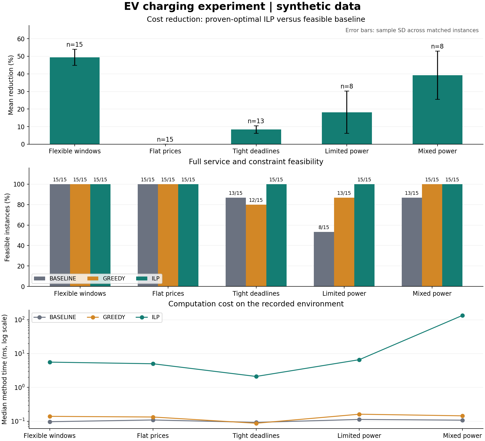
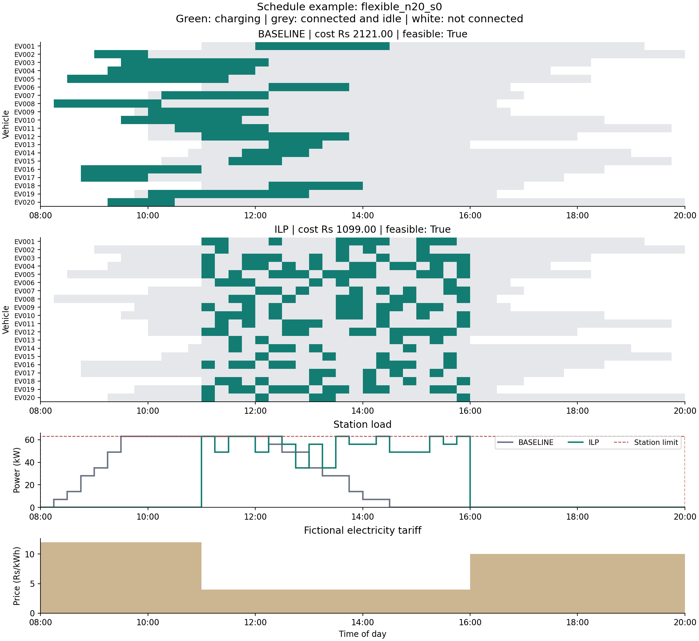

# Track E: EV Charging Schedule Optimization

All sessions and tariffs in this report are synthetic. These are measured software experiment results, not field deployment savings.

## Problem and formulation

Minimize electricity cost while giving every EV its required energy within its connection window and respecting per-EV fixed power and the station limit. Each vehicle has an assigned plug. Charging may pause and resume at slot boundaries.

Binary x[i,t] indicates whether EV i charges in slot t. Minimize sum(price[t] * power[i] * slot_hours * x[i,t]); require sum_t x[i,t] = required_slots[i], sum_i power[i] * x[i,t] <= capacity[t], and x[i,t] = 0 outside [arrival[i], departure[i]). See docs/FORMULATION.md for assumptions and strategy selection.

## Experimental protocol

75 main instances, plus 4 diagnostic controls; 3 timing repetitions per method and instance; 711 method runs in total. Fleet sizes: [10, 20, 30]; seeds: [0, 1, 2, 3, 4]. Main instances use 48 fifteen-minute slots (08:00-20:00).

The baseline charges immediately with arrival-order priority. Greedy processes earlier departures first and reserves each EV's cheapest available slots. ILP considers all vehicles jointly. All methods receive the same full input. Inputs are not withheld to create a look-ahead advantage.

ILP uses SciPy/HiGHS with relative MIP gap target 0 and 3 s per solve. Timings include method execution and ILP model construction, exclude imports, plotting and independent checking, and follow one untimed solver warm-up. Method order is deterministically shuffled. Runtime summaries are medians across per-instance median repetition times.

Quality/feasibility summaries use repetition 0, fixed in advance. All repetitions are retained in raw_runs.json and runs.csv. Savings compare matching feasible instances only and require an optimal ILP status. A failed heuristic's lower cost is not a saving. SD below describes variation across synthetic instances, not a confidence interval.

## Results

| Scenario | FCFS feasible | Greedy feasible | ILP feasible | ILP optimal | Paired FCFS cases | Mean cost reduction +/- SD |
|---|---:|---:|---:|---:|---:|---:|
| Flexible windows | 15/15 | 15/15 | 15/15 | 15/15 | 15 | 49.44% +/- 4.55 pp |
| Flat prices | 15/15 | 15/15 | 15/15 | 15/15 | 15 | 0.00% +/- 0.00 pp |
| Tight deadlines | 13/15 | 12/15 | 15/15 | 15/15 | 13 | 8.36% +/- 2.14 pp |
| Limited power | 8/15 | 13/15 | 15/15 | 15/15 | 8 | 18.14% +/- 12.04 pp |
| Mixed power | 13/15 | 15/15 | 15/15 | 10/15 | 8 | 39.25% +/- 13.72 pp |

| Scenario | Baseline median ms | Greedy median ms | ILP median ms | ILP reduction vs feasible greedy |
|---|---:|---:|---:|---:|
| Flexible windows | 0.097 | 0.139 | 5.588 | 2.80% (n=15) |
| Flat prices | 0.109 | 0.133 | 5.003 | 0.00% (n=15) |
| Tight deadlines | 0.093 | 0.087 | 2.106 | 0.04% (n=12) |
| Limited power | 0.113 | 0.161 | 6.600 | 0.50% (n=13) |
| Mixed power | 0.107 | 0.145 | 134.568 | 3.64% (n=10) |

ILP certified 70/75 main instances as optimal. 5 reached the time limit with a candidate; these candidates passed the independent schedule audit. They are included in feasibility and runtime counts, but excluded from the proven-optimum savings comparisons above. This conditional comparison must not be presented as savings over all instances.

## Interpretation

Flexible connection windows allow demand to move into cheaper periods. Flat tariffs remove this cost-shifting opportunity: any fully served schedule costs the same when per-vehicle energy is fixed. Tight deadlines reduce freedom. Restricted station power creates competition for the cheap slots. Mixed charger powers introduce discrete packing choices.

Greedy can be fast and competitive, but has no feasibility or optimality guarantee for this formulation. ILP returns an optimum only when it proves the requested gap within the time limit. A time-limited candidate must still pass the independent audit; an infeasible status is different from running out of time.

## Diagnostic controls

| Control | Method | Status | Feasible | Delivered kWh | Unmet kWh | Actual cost Rs |
|---|---|---|---|---:|---:|---:|
| teaching_variable | ilp | optimal | True | 35.00 | 0.00 | 182.00 |
| teaching_variable | baseline | candidate | True | 35.00 | 0.00 | 406.00 |
| teaching_variable | greedy | candidate | True | 35.00 | 0.00 | 182.00 |
| teaching_flat | greedy | candidate | True | 35.00 | 0.00 | 280.00 |
| teaching_flat | ilp | optimal | True | 35.00 | 0.00 | 280.00 |
| teaching_flat | baseline | candidate | True | 35.00 | 0.00 | 280.00 |
| greedy_trap | greedy | candidate | False | 14.00 | 7.00 | 21.00 |
| greedy_trap | ilp | optimal | True | 21.00 | 0.00 | 35.00 |
| greedy_trap | baseline | candidate | True | 21.00 | 0.00 | 35.00 |
| infeasible_capacity | greedy | candidate | False | 7.00 | 3.50 | 56.00 |
| infeasible_capacity | baseline | candidate | False | 7.00 | 3.50 | 56.00 |
| infeasible_capacity | ilp | infeasible | False | n/a | n/a | n/a |

The teaching examples and greedy trap use one-hour slots for hand calculation; the overload control uses fifteen-minute slots. The deliberately infeasible capacity control needs six charging slots but has room for four. The greedy-trap control is feasible: reserving the cheapest slot for an earlier-departing flexible vehicle blocks a later vehicle's scarce window. These are designed algorithm controls, not fabricated AI mistakes.

## Correctness and reproducibility

An independent checker recomputes cost and energy from the returned schedule and input, checks binary values, availability, exact demand and slotwise station power. It does not use the solver constraint matrix or trust solver status. Exhaustive enumeration checks the integer model on 80 seeded small random cases and analytic examples. The 29-test suite also exercises malformed inputs, fractional schedules, deadline boundaries and infeasible cases.

Every generated main instance has an audited feasibility witness, saved separately and never supplied to any solver. Generation can retry up to 100 times and records the successful attempt. This intentionally selects feasible workloads; it is not an unbiased sample of real charging demand. Inputs have SHA-256 hashes. Seeds reproduce datasets; solver ties and timing may vary by system/version.

## Representative schedule

Preselected case: flexible_n20_s0.

## Limitations and next steps

This is an offline, synthetic, fixed-rate, preemptive charging model with an assigned plug per vehicle. Energy is specified as an integer number of charging slots; no physical energy request is silently rounded. Tariffs are fictional. The model excludes forecast error, battery tapering/degradation, charging losses, user price response, vehicle movement and plug queues. Peak power is measured and capped, not minimized. No claim of real station savings or deployment readiness is made.

With identical powers and integral per-slot capacity in charger units, this model has a bipartite assignment/min-cost-flow structure; binary variables alone do not make that restricted case hard. Heterogeneous rates remove that simple unit-capacity interpretation. Solver scaling observations should be limited to these tested instances.

A next study could add public charging-session data, explicitly mapped demand and tariff assumptions, or rolling-horizon decisions with uncertain departures. Extra constraints and finer slots increase computational work. Full Assignment 8 still needs Tracks A-D and F-J, the full Chapter 6 checklist, a second AI-tool comparison, genuine failure records, public repository publication and the demonstration.

## Environment

- Recorded UTC: 2026-10-31T08:55:05.184077+00:00
- Python: 3.12.14 (main, Aug 25 2026, 14:00:49) [Clang 22.1.3 ]
- NumPy 2.3.5, SciPy 1.17.0
- CPU: AMD EPYC 9V74 80-Core Processor
- Logical/affinity CPU counts: 9/9; cgroup cpu.max: 800000 100000
- Sequential methods/runs; HiGHS internal threading not explicitly configured. No GPU used.

## Sources

- Supplied Assignment 8 brief: main-process case study, comparison and reproducibility requirements.
- Supplied Chapter 6 PPT1: greedy/ILP; PPT4: strategy selection.
- SciPy milp reference: https://docs.scipy.org/doc/scipy/reference/generated/scipy.optimize.milp.html (accessed 2026-10-31). Installed version is recorded above.
- ACN-Data (candidate future real-data source; not used in these results): https://ev.caltech.edu/dataset
