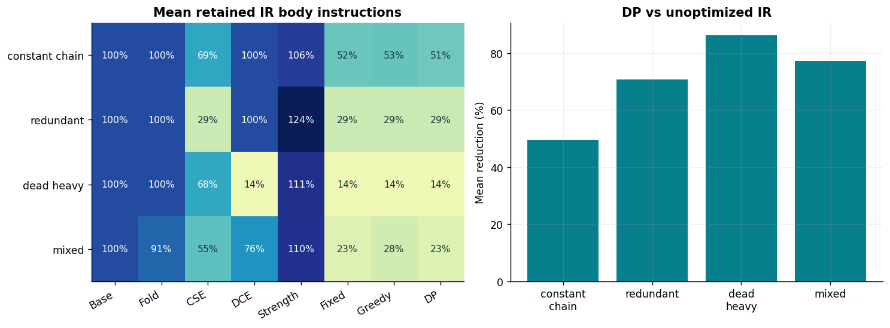
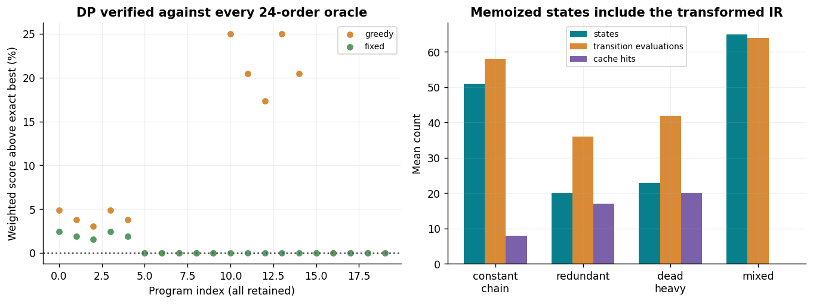
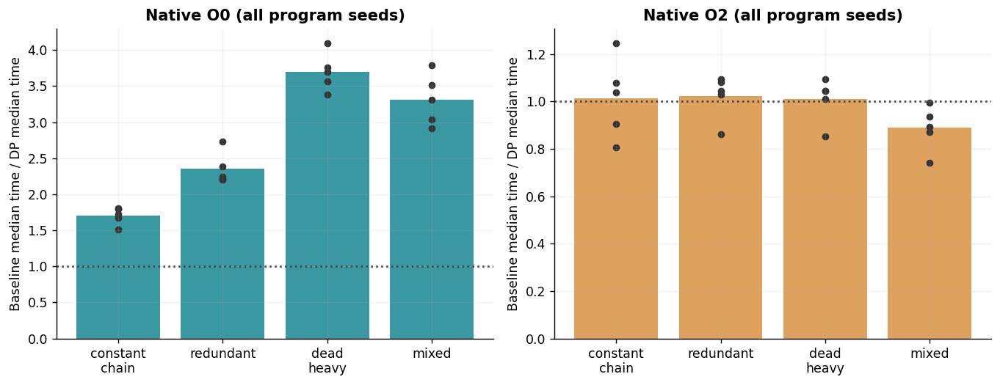
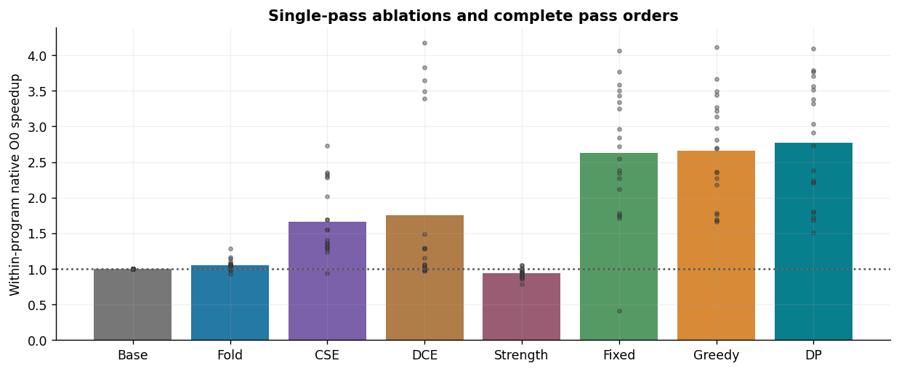
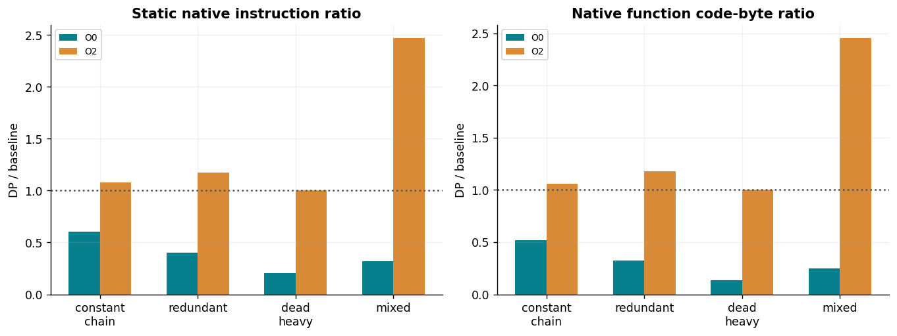
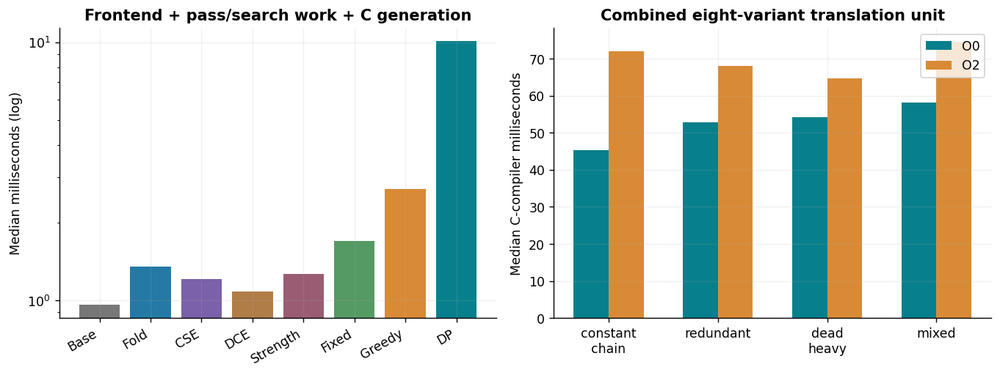

# Track F: Compiler Optimization

Prepared for Akshat Tikaria, roll number 241070005. Assignment 8.

This package implements a complete small arithmetic compiler: an explicit lexer, precedence parser, immutable three-address SSA, four optimization passes, a register interpreter and C code generation. It compares the same programs with eight compiler variants and two native host-compiler levels. All reported runtime and code-size numbers are measured from the retained artifacts. This is a toy-language study, not a production C compiler or an LLVM/GCC plugin.

# Protocol and measurements

| Evidence | Recorded work |
| --- | --- |
| Programs | 20 synthetic programs: four families × 5 seeds |
| Compiler variants | baseline, fold_only, cse_only, dce_only, strength_only, fixed, greedy_order, dp_order |
| Python compilation | 480 measured compilations; 3 repeats/variant/program |
| Native runtime | 1000 timings; 5 repeats; 100,000 calls/timing |
| Native builds | 40 real shared-library builds, at O0/O2 |
| Function metrics | 320 native symbol/disassembly records |
| Pass-order references | 480 complete four-pass permutations |
| Equivalence | 5,280 IR and 10,560 native input/output comparisons |

Native compiler: cc (Ubuntu 13.3.0-6ubuntu2~24.04) 13.3.0. Python: 3.12.14 (main, Aug 25 2026, 14:00:49) [Clang 22.1.3 ]. Runs are serial CPU measurements on a shared cloud workspace; no student-laptop, GPU, dedicated-core or parallel speedup claim is made.

Every native timing uses the same varying-input LCG driver, checksum, iteration count and seed within a comparison. Trial order is predeclared and shuffled. Medians use all timing repeats; figures aggregate the within-program median ratios across generated programs. Dots show every program seed, not selected best runs. Native function boundaries are kept with noinline; the driver and indirect call overhead remain in all timings.

# Language and correctness assumptions

Functions have immutable let bindings and one return; at most eight uint64 arguments. Supported expressions are +, −, *, bitwise XOR/AND/OR and left/right shifts. Every arithmetic result wraps modulo 2^64; shift counts are masked to 0–63. Right shift is logical unsigned. There are no branches, source loops, mutable stores, pointers, I/O, division or exceptions. These restrictions make each expression pure and total, which is essential for dead-code removal and common-expression reuse.

```
fn demo(x,y,z) {
    let dead = x * y;
    let k = 2 * 4;
    let a = x + y;
    let b = y + x;
    return a * k + b * 8 + 0;
}
```

The parser enforces definition-before-use, immutable names, literal bounds, argument count and syntax. The native backend uses unsigned C11 arithmetic and explicitly masks shift counts. It does not depend on undefined signed overflow or unsafe floating-point reassociation. AST, IR and generated native C are compared on zero, boundary, high-bit, wraparound and random inputs; a separate AST loop verifies the native benchmark checksum.

# Four implemented passes

| Pass | Transformation | Condition |
| --- | --- | --- |
| Fold/propagate | Compute constant expressions; propagate aliases/constants; valid uint64 identities | Preserve modulo arithmetic and masked shifts |
| CSE | Reuse identical SSA expressions; canonicalize commutative operands | Immutable definitions and pure operations |
| DCE | Backward liveness from the returned result | Unused operations have no side effects or traps |
| Strength reduction | Multiply by 2^k becomes left shift by k | Unsigned wrap semantics; k in 0–63 |



All eight variants are retained. An IR body count includes argument loads and constants but excludes the final return and benchmark driver; in this straight-line language each retained IR instruction executes once per invocation.
Fold/propagate is counted as one combined pass; there are four separately implemented transformations. Strength reduction can temporarily add a shift-count constant while leaving the old constant dead, so a later DCE/CSE pass can matter. No loop optimization or register allocation is claimed.

| Family | Mean IR count reduction | Mean generated C-function byte reduction |
| --- | --- | --- |
| constant_chain | 49.49% | 47.92% |
| redundant | 70.63% | 69.68% |
| dead_heavy | 86.27% | 85.47% |
| mixed | 77.28% | 76.04% |


# Compiler decision as dynamic programming

Decision variables choose an ordering of the four passes, each used exactly once. The objective is final weighted IR cost: multiplication=4; every other retained instruction=1. These are fixed teaching-model weights, not measured CPU cycles. The constraint is a permutation of the four supported passes.

State is (used-pass bit mask, canonical transformed IR). A transition applies an unused pass; the terminal value is the final IR score. The recurrence takes the minimum terminal score over all legal next passes, with memoization and a deterministic tie break. Keeping only the subset would be wrong because different orders can leave different IR for the same subset. Canonical renumbering merges structurally equal SSA states.

The fixed baseline is fold→CSE→strength→DCE. Greedy selects the pass with the best immediate score; DP looks through the remaining interactions. An independent enumeration of all 24 permutations checks each finite optimum. The certificate covers this score and search space; it is neither global compiler optimality nor native-runtime optimality.



DP matches every exhaustive oracle; memoization shares identical transformed states rather than assuming all pass orders commute.
DP obtained a strictly lower score than greedy on 10/20 programs. Four passes make exact verification practical; search-state growth can become expensive with a larger pass set. The report retains search work and compilation cost alongside final code quality.

# Measured native runtime



Bars are arithmetic means of within-program median-time ratios. Each dot is one generated program; the two panels use separate vertical scales.
| Family | Mean O0 speedup | O0 program range | Mean O2 speedup | O2 program range |
| --- | --- | --- | --- | --- |
| constant_chain | 1.702 | 1.507–1.806 | 1.015 | 0.808–1.246 |
| redundant | 2.354 | 2.206–2.732 | 1.022 | 0.861–1.094 |
| dead_heavy | 3.701 | 3.380–4.094 | 1.009 | 0.852–1.093 |
| mixed | 3.314 | 2.911–3.789 | 0.889 | 0.742–0.996 |

The O0 comparison isolates pedagogical pass effects with most host optimization disabled. It must not be presented as outperforming an optimizing production compiler. At O2, the host compiler already removes many redundancies, so additional gains are small, inconsistent or negative. Code shape, alignment, kernel overhead and timing variability also matter; a lower synthetic IR score need not imply lower native runtime. No statistical-significance claim is made from a few short shared-host measurements.



Single-pass variants show that one transformation can help a family, have little effect, or add overhead. Only baseline and DP are timed at O2; all eight variants are timed at O0.

# Instruction counts and code size



Native instruction counts come from saved objdump disassembly; function code bytes come from nm symbol sizes. These are static quantities, not retired CPU instruction counts.
Function source bytes are measured on the generated function text. Native symbol bytes exclude the shared benchmark driver and most shared-library metadata. Each library contains all eight variants, so total library file size is recorded as build information and is not misrepresented as one variant’s executable size. Disassembly counts may include compiler-inserted alignment/padding. At O2, some cases converge while others grow; this exposes a mismatch between the teaching cost model and the native target. In the mixed family, DP averaged about 2.45 times the baseline function bytes and a 0.889 runtime ratio (baseline time / DP time). Raw source, IR, C, assembly and symbol metrics are retained for inspection.

# Compile-time trade-off



Python time includes a fresh lex/parse/lower, optimization/search and function generation for each variant. C compiler time belongs to the combined eight-variant translation unit.
| Variant | Median Python compile ms | Median optimization/search ms |
| --- | --- | --- |
| baseline | 0.9624 | 0.0007 |
| fold_only | 1.3524 | 0.3165 |
| cse_only | 1.2065 | 0.2349 |
| dce_only | 1.0806 | 0.1508 |
| strength_only | 1.2660 | 0.2504 |
| fixed | 1.7018 | 0.7929 |
| greedy_order | 2.7081 | 1.7192 |
| dp_order | 10.0751 | 8.9926 |

Greedy considers ten candidate transitions. DP explores more states and caches repeated states, increasing compilation work to obtain the exact finite score optimum. Runtime gains amortize compilation cost only if generated code runs enough times. Native compilation is measured separately and is not divided arbitrarily among variants. All stage timings are retained, so one can distinguish source transformation from the external host compiler.

# Validation, AI revision and limits

All 29 unit tests pass, including 6,000 random-program/all-order differential cases, overflow and masked shifts, every power-of-two strength rewrite, independent AST/IR evaluation, and native O0/O2 comparisons. The saved-data audit checks inputs, compiled outputs, C regeneration, disassembly counts, all 24-order certificates and same-seed runtime checksums, and freshly recompiles C under both levels. Its exact counts are in audit.json.

A genuine AI-generated search-work defect was caught before the recorded benchmarks: greedy transformed every candidate twice, but reported ten transitions. Instrumentation observed twenty transformation calls. Reusing each computed candidate fixed the waste and accounting; the original/fix commits, observation and regression are retained. Earlier A/B/D packages already contain three other corrected cases. No manual student correction or independent second-tool comparison is claimed.

This is a small, pure straight-line language and four-pass cost-model study. Differential checks are finite evidence; pass-soundness arguments rely on the declared pure/total unsigned semantics. No branch/loop correctness proof, production workload generalization, LLVM plugin, universal performance ranking or hardware-cycle optimum is claimed. Next is Track G (xv6), followed by H/I/J and final integration; outstanding research-paper reproductions, full chat exports, second-tool comparison, public repository and demonstration remain open.

# Primary references

- Supplied Assignment 8, Track F, and Chapter 6 discrete/strategy-selection material. Lecture files are acknowledged rather than redistributed.
- LLVM transform-pass reference: https://llvm.org/docs/Passes.html (conceptual reference; no LLVM dependency).
- GCC optimization levels: https://gcc.gnu.org/onlinedocs/gcc/Optimize-Options.html
- GCC function attributes: https://gcc.gnu.org/onlinedocs/gcc/Common-Function-Attributes.html
- Public references checked 2026-11-04. All experiment numbers come from the retained local runs; the toy language’s unsigned semantics and score are explicitly defined here.
