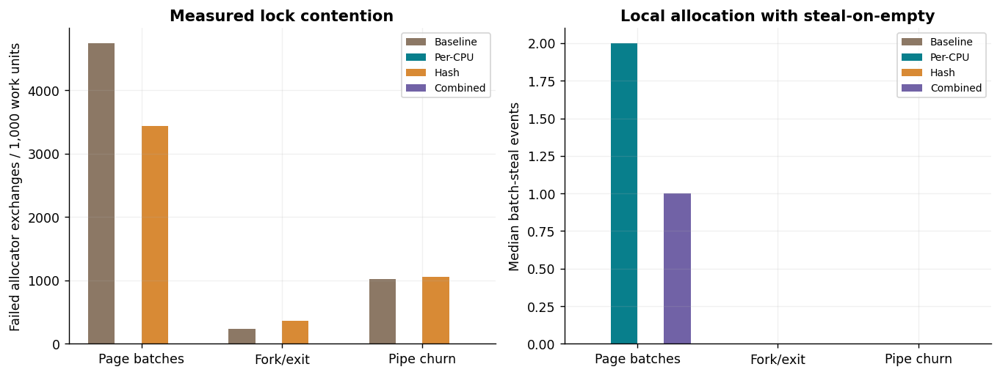
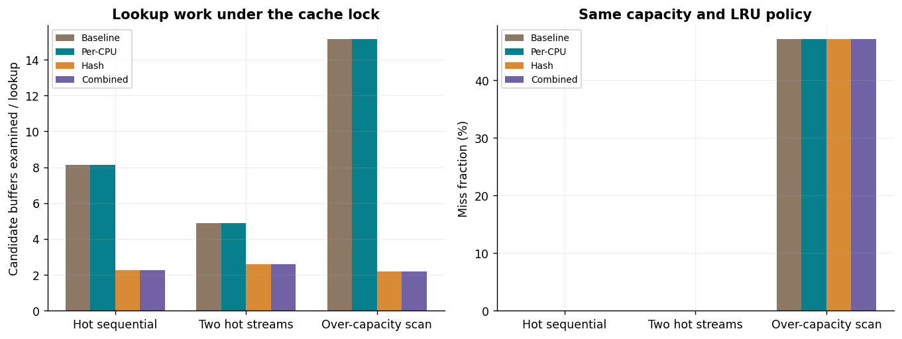
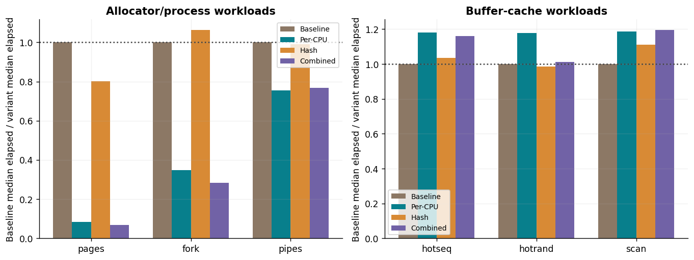

# Track G: xv6 Operating-System Optimization

Prepared for Akshat Tikaria, roll number 241070005. Assignment 8.

This package modifies and boots the real MIT xv6 RISC-V kernel in QEMU. It implements per-CPU physical-page allocation with batch stealing, and a hash index for buffer lookup while retaining the original global cache lock and LRU replacement. Measurements come from new guest programs and raw UART logs. They are emulated guest results, not a native laptop or production-OS speed claim.

# Main measured findings

The allocator-only page workload reduced median failed exchanges from 182,069 to 0, but elapsed time increased from 0.3919 to 4.6821 seconds (11.95 times slower). Thus the contention objective improved while end-to-end elapsed performance regressed sharply. The cause of that regression has not been isolated; zero measured spinning does not mean the implementation is fast.

| Hash-only cache workload | Lookup-probe reduction | Elapsed ratio vs baseline |
| --- | --- | --- |
| hotseq | 72.09% | 1.036 |
| hotrand | 46.68% | 0.985 |
| scan | 85.60% | 1.111 |

Hashing reduces search work in every cache workload. Miss fractions remain the same in the recorded runs. Timing benefits are smaller and workload-dependent, including a negative elapsed result for the two-stream case; three emulated repetitions do not prove a statistically significant native speedup. All slow configurations and all repetitions remain in the report.

# Source, setup and validation

Official xv6 commit: e93dabeb98431235c6e1a101cb96c73c923fdbc4. All 82 upstream Git blob hashes were verified; the original MIT license is retained. Toolchain: QEMU emulator version 8.2.2 (Debian 1:8.2.2+ds-0ubuntu1.18); riscv64-linux-gnu-gcc (Ubuntu 13.3.0-6ubuntu2~24.04.1) 13.3.0. Each measured guest has 3 vCPUs and 128 MiB RAM. No KVM, GPU or network device is required.

| Configuration | Per-CPU allocator | Hash lookup | Full upstream usertests | Custom checks |
| --- | --- | --- | --- | --- |
| baseline | 0 | 0 | 74 named tests: PASS | Before/after: PASS |
| percpu | 1 | 0 | 74 named tests: PASS | Before/after: PASS |
| hash | 0 | 1 | 74 named tests: PASS | Before/after: PASS |
| combined | 1 | 1 | 74 named tests: PASS | Before/after: PASS |

The pristine unmodified kernel also passed all 74 named tests. These runs include the slow tests, not just usertests -q. Intentional invalid-memory tests print traps and out-of-space messages; the final ALL TESTS PASSED result and complete named-test set establish success. gcheck additionally validates free-list uniqueness/counts, cache-key uniqueness, LRU/hash membership, page contents, statistics ABI and invalid user destinations. This is finite correctness evidence, not a formal race-freedom proof or a KCSAN run.

# Optimization and invariants

| Feature | Decision and objective | Preserved invariant |
| --- | --- | --- |
| Per-CPU pages | Prefer a local free list; steal at most 32 pages only when empty. Reduce shared-lock contention. | Pin cpuid with interrupts disabled; detach under victim lock, publish extras under local lock; normal paths hold one allocator lock at a time. |
| Buffer hash index | Search one of 13 buckets instead of scanning all 30 buffers. Reduce lookup comparisons under the existing lock. | Keys/hash/LRU/reference counts remain protected by bcache.lock; one cached buffer per device/block; only unreferenced buffers recycled. |

The allocator uses dynamic load balancing through steal-on-empty, reusing the parallelism concepts from Chapter 6. Hash lookup changes the search structure, not cache capacity, eviction order, block contents, per-buffer sleep locking or log pinning. It is not a sharded or lock-free cache. Both changes have metadata and bookkeeping costs. The baseline disables both features but retains identical instrumentation/check interfaces; it is distinguished from the separately validated pristine kernel.

# Six workloads and timing

| Kind | Recorded iterations | Work unit and checks |
| --- | --- | --- |
| pages | 800 | Three workers; 16 eager pages/batch; verify first/last bytes before freeing. |
| fork | 200 | Three workers repeatedly fork/wait; grandchild status checked. |
| pipes | 8000 | Three workers create/write/read/close pipes; every byte checked. |
| hotseq | 8000 | One warmed 16-block sequential file stream. |
| hotrand | 8000 | Pseudo-random interleaving of two warmed eight-block streams. |
| scan | 8000 | One 96-block file stream exceeds the 30-buffer cache. |

There are 72 measured runs over four configurations and 3 repetitions, with a fresh filesystem image/boot per configuration and repetition. Workload order is deterministically shuffled and matched by repetition. All six workloads finish with invariants checked. Cache setup/sync/warmup and file cleanup lie outside the measured interval. Worker creation/readiness is outside the allocator interval; work, exit and reaping are inside it. This explains why frees can exceed measured allocations: the initial worker copies are freed inside the interval.

Elapsed time uses guest r_time, with a frequency of 10,000,000 Hz read from QEMU’s device tree. This is a virtual time counter, not retired CPU cycles. Snapshot overhead and observation-lock acquisitions remain included. Host command latency includes setup and output and is retained only as ancillary evidence. Shared-host scheduling and QEMU overhead limit performance generalization; three repeats do not establish statistical significance.

# Allocator contention and balancing

Failed atomic exchanges count spins after losing the allocator lock. A zero baseline is reported as zero rather than an invented percentage improvement. Work units differ across the three workloads.
| Workload | Configuration | Median failed exchanges | Allocator lock acquisitions | Batch steals |
| --- | --- | --- | --- | --- |
| pages | baseline | 182069 | 76834 | 0 |
| pages | percpu | 0 | 76855 | 2 |
| pages | hash | 131885 | 76834 | 0 |
| pages | combined | 187 | 76848 | 1 |
| fork | baseline | 144 | 13234 | 0 |
| fork | percpu | 0 | 13241 | 0 |
| fork | hash | 220 | 13234 | 0 |
| fork | combined | 0 | 13241 | 0 |
| pipes | baseline | 24565 | 48034 | 0 |
| pipes | percpu | 0 | 48041 | 0 |
| pipes | hash | 25302 | 48034 | 0 |
| pipes | combined | 0 | 48041 | 0 |

Fewer failed exchanges support a contention claim only for the measured workload. A speed benefit does not follow automatically: page poisoning/zeroing, process-table locks, scheduling and batch-transfer overhead may dominate. Empty local lists can cause extra victim scans; free memory is shared through stealing rather than statically partitioned or lost.

# Buffer lookup and miss behavior

Probes count cache lookup comparisons; miss fraction counts bget misses. Metadata lookups are included. The hot-stream and over-capacity cases expose distinct locality conditions.
| Workload | Configuration | Probes/lookup | Probe reduction vs baseline | Miss fraction |
| --- | --- | --- | --- | --- |
| hotseq | baseline | 8.132 | 0.00% | 0.00% |
| hotseq | percpu | 8.132 | 0.00% | 0.00% |
| hotseq | hash | 2.270 | 72.09% | 0.00% |
| hotseq | combined | 2.270 | 72.09% | 0.00% |
| hotrand | baseline | 4.881 | 0.00% | 0.00% |
| hotrand | percpu | 4.881 | 0.00% | 0.00% |
| hotrand | hash | 2.603 | 46.68% | 0.00% |
| hotrand | combined | 2.603 | 46.68% | 0.00% |
| scan | baseline | 15.148 | 0.00% | 47.16% |
| scan | percpu | 15.148 | 0.00% | 47.16% |
| scan | hash | 2.182 | 85.60% | 47.16% |
| scan | combined | 2.182 | 85.60% | 47.16% |

A smaller lookup search does not imply fewer disk reads. The capacity and LRU policy are unchanged, so a scan can continue missing heavily while doing less comparison work. The global cache lock remains; any contention or parallel scalability claim is limited accordingly. Hash collisions and uneven bucket occupancy remain possible.

# Measured elapsed-time trade-offs

Ratios use all repetitions’ medians for the same workload. Values below one are slowdowns and remain in the data.
| Workload | Configuration | Median guest seconds | Min–max guest seconds | Elapsed ratio |
| --- | --- | --- | --- | --- |
| pages | baseline | 0.39190 | 0.36088–0.48777 | 1.000 |
| pages | percpu | 4.68213 | 4.41920–4.97464 | 0.084 |
| pages | hash | 0.48850 | 0.39356–0.49195 | 0.802 |
| pages | combined | 5.84704 | 5.21880–6.16163 | 0.067 |
| fork | baseline | 0.67274 | 0.59083–0.72060 | 1.000 |
| fork | percpu | 1.93360 | 1.90908–1.97818 | 0.348 |
| fork | hash | 0.63272 | 0.57632–0.65892 | 1.063 |
| fork | combined | 2.37793 | 1.96121–2.40456 | 0.283 |
| pipes | baseline | 4.31119 | 4.11453–4.32115 | 1.000 |
| pipes | percpu | 5.70708 | 5.64881–5.72591 | 0.755 |
| pipes | hash | 4.35322 | 3.74109–5.01628 | 0.990 |
| pipes | combined | 5.61655 | 5.53992–5.88584 | 0.768 |
| hotseq | baseline | 1.54568 | 1.51979–1.71562 | 1.000 |
| hotseq | percpu | 1.30870 | 1.24484–1.38111 | 1.181 |
| hotseq | hash | 1.49154 | 1.48879–1.55221 | 1.036 |
| hotseq | combined | 1.33247 | 1.31051–1.39363 | 1.160 |
| hotrand | baseline | 2.14888 | 2.07742–2.31203 | 1.000 |
| hotrand | percpu | 1.82599 | 1.75139–1.92095 | 1.177 |
| hotrand | hash | 2.18174 | 2.04560–2.22977 | 0.985 |
| hotrand | combined | 2.12236 | 1.76962–2.28932 | 1.012 |
| scan | baseline | 4.52495 | 3.80141–5.49703 | 1.000 |
| scan | percpu | 3.81381 | 3.62467–3.98388 | 1.186 |
| scan | hash | 4.07200 | 3.93167–5.08706 | 1.111 |
| scan | combined | 3.78520 | 3.56922–3.82115 | 1.195 |

Interpret elapsed time together with lock/probe counts and raw spread. Emulation, scheduling, disk service and memory clearing can outweigh the targeted savings. These ratios are neither native host parallel speedups nor guarantees for other machines, cache sizes or workloads. No slow or inconvenient run has been replaced by theoretical values.

# Verification, AI correction and remaining scope

The audit matches every numeric record to raw UART output, checks work units/feature flags/time conversion, verifies source/UART hashes and confirms the complete upstream test sets for all configurations. Host parser/provenance tests are additional checks and are kept separate from real guest usertests. The patch is included and checked against the exact pristine snapshot.

A real AI-generated compatibility error used an older four-argument copyout call. The pinned xv6 API requires five arguments, including process size for lazy-memory bounds. The compiler rejected it; the fix supplies p->sz. The original build failure, original/fix commits and invalid-destination guest check are retained. No manual student correction or independent second-AI-tool comparison is claimed.

Two kernel features and six workloads satisfy Track G’s core scope. H (DBMS), I (remaining quantum/QML), J (software engineering), the combined submission, outstanding research reproductions, full chat exports, second-tool comparison, public repository and live demonstration remain open. Earlier packages are preserved. No production security or formal verification claim is made.

# Primary references

- Official xv6 source and MIT license: https://github.com/mit-pdos/xv6-riscv
- Pinned commit: https://github.com/mit-pdos/xv6-riscv/commit/e93dabeb98431235c6e1a101cb96c73c923fdbc4
- MIT tools: https://pdos.csail.mit.edu/6.1810/2025/tools.html
- MIT lock lab, per-CPU free-list/stealing concepts: https://pdos.csail.mit.edu/6.1810/2025/labs/lock.html
- Supplied Assignment 8 Track G. References accessed 2026-11-04. These measurements are this project’s own; MIT’s illustrative results are not reused.
