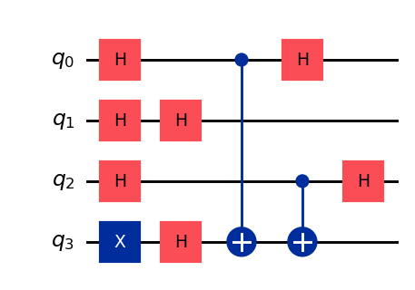
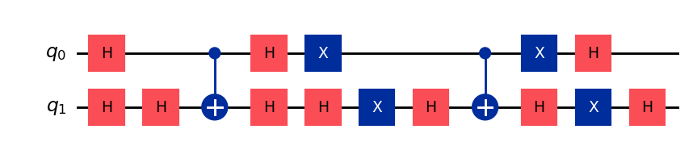
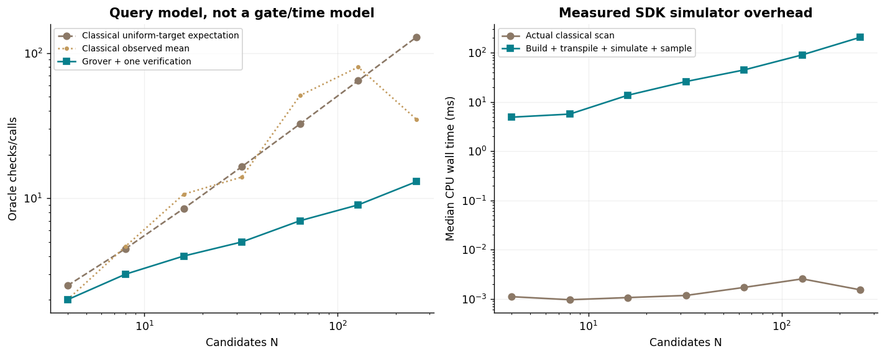
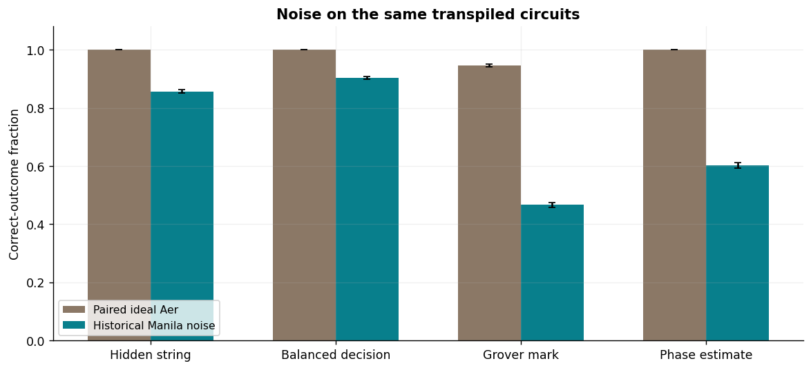
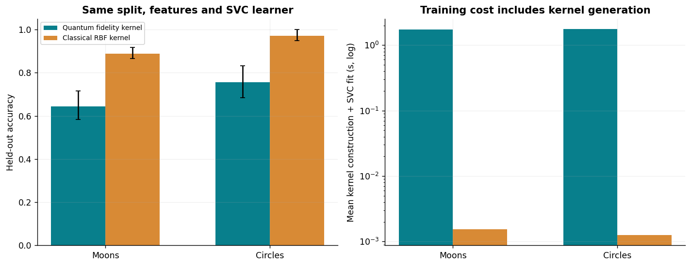
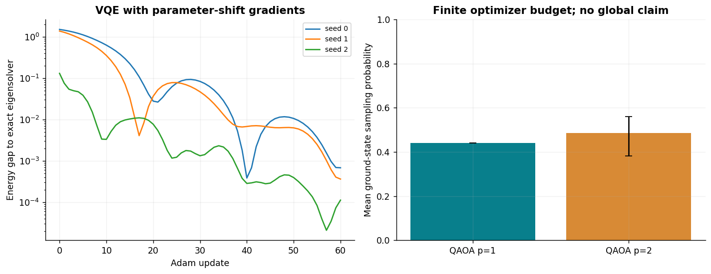

# Track I: Quantum Algorithms and QML Comparison

Prepared for Akshat Tikaria, roll 241070005. Optimization Techniques, Assignment 8.

This is a CPU simulation study using Qiskit Statevector and Qiskit Aer, explicit algorithm circuits, a saved device-calibration noise model, and matched quantum/classical kernel classifiers. No physical quantum processor was used. Smaller logical oracle counts are distinguished from physical gates and CPU wall time; no practical quantum speedup is claimed.

# Main findings

| Dataset | Quantum-kernel SVC accuracy | RBF-kernel SVC accuracy |
| --- | --- | --- |
| moons | 64.44% | 88.89% |
| circles | 75.56% | 97.22% |

Each value averages 3 dataset/split seeds. The fixed two-qubit kernel scores lower on 2 of two datasets and takes longer to train in simulation on 2 of two. This does not rank all possible QML models. Grover exhibits its expected logical query scaling while the simulator is much slower than the tiny classical search. The historical device noise reduces success in the four tested programs. All outcomes and finite-budget optimizer statuses are retained.

# Setup, source and existing coverage

| Component | Recorded value |
| --- | --- |
| Python | 3.12.14 |
| Qiskit / Aer | 2.6.1 / 0.18.2 |
| Runtime snapshot provider | 0.51.0 |
| scikit-learn | 1.8.0 |
| Main seeds | [0, 1, 2] |
| Noise shots per condition/seed | 4096 |
| Classifier train / held-out records | 60 / 60 |
| Thread policy | One numerical-library thread; Aer max_parallel_threads=1 |

The supplied quantum deck has 41 slides. It explicitly teaches Deutsch, Grover, VQE, QAOA, parameterized circuits and barren plateaus. Assignment Section 5 additionally names Deutsch-Jozsa, Bernstein-Vazirani, QFT, QPE, Shor, annealing and quantum kernels, all demonstrated here. Track C already supplies parameter-shift/SPSA/QNG, finite-shot VQE and gradient-concentration diagnostics; unchanged earlier summaries/audit/protocols are included with hashes. They remain earlier C measurements, not fresh I executions. Exact serving-model revision and full conversation exports remain disclosure tasks.

# Explicit algorithms and mathematical checks

| Algorithm | Experiment and verification | Scope |
| --- | --- | --- |
| Deutsch | All four one-bit Boolean oracles; constant/balanced decision from one query | Promise problem, two classical evaluations in the deterministic worst case |
| Deutsch-Jozsa | Two constants, linear/nonlinear balanced three-bit truth tables; promised decision | Truth-table oracle construction is exponential and is charged as one abstract black-box call only |
| Bernstein-Vazirani | Three-bit hidden strings 000, 011, 101, 111 | Efficient explicit CNOT oracle; one logical quantum query versus n classical bit queries |
| QFT | 2–4-qubit circuits compared with the complete dense Fourier unitary | Uniform measurement alone is not accepted as correctness proof |
| QPE | Exact phases 0 and 3/8; off-grid phase 1/3 | Full distribution checked against the finite Fourier/Dirichlet formula |
| Shor order finding | N=15, multipliers 2, 7, 11, 14; QPE and continued-fraction/GCD postprocessing | Dense reversible modular multiply, not scalable arithmetic or a general factoring speed benchmark |
| Quantum annealing | Closed-system gate-based Trotter schedule on a four-bit Max-Cut problem | Separate dense time-evolution reference and classical simulated annealing; no annealer hardware |

The QFT uses positive Fourier phases, inverse QFT in phase estimation, and little-endian register integers. Shor leaves unused basis state 15 unchanged, preserving unitarity. Postprocessing rejects unhelpful zero/half-period or minus-one results rather than searching periods classically to manufacture success. The a=14 failure control is retained. No built-in complete algorithm constructors replace the explicit circuits.

# Two handwritten circuit examples

Bernstein-Vazirani for hidden string 101. The ancilla creates phase kickback, CNOTs implement the oracle, and final Hadamards recover the hidden bits.

Two-qubit Grover search for mark 11 with one amplification round. Oracle and diffuser are explicit gates. Its global phase convention does not affect outcome probabilities.

# Grover query complexity and measured time

The query plot separates the analytic uniform-target classical expectation from the observed mean checks on the sampled marks. The time plot is CPU simulation, not QPU execution.
| N | Grover search + verify | Classical uniform expected checks | Observed classical mean | Ideal marked probability | Compiled CX gates | Median simulator ms |
| --- | --- | --- | --- | --- | --- | --- |
| 4 | 1 + 1 | 2.5 | 2.0 | 1.00000 | 2 | 4.907 |
| 8 | 2 + 1 | 4.5 | 4.7 | 0.94531 | 24 | 5.667 |
| 16 | 3 + 1 | 8.5 | 10.7 | 0.96132 | 84 | 13.692 |
| 32 | 4 + 1 | 16.5 | 14.0 | 0.99918 | 288 | 25.982 |
| 64 | 6 + 1 | 32.5 | 51.0 | 0.99659 | 984 | 44.719 |
| 128 | 8 + 1 | 64.5 | 80.0 | 0.99562 | 1952 | 90.481 |
| 256 | 12 + 1 | 128.5 | 35.0 | 0.99995 | 4080 | 206.329 |

With one marked item, r is rounded from pi/(4 asin(1/sqrt(N))) minus 1/2; the marked probability is sin squared of (2r+1)asin(1/sqrt(N)). The known black-box advantage is quadratic query scaling. Some sampled targets are found early by linear search, and one amplification attempt is probabilistic. Raw outcomes and verification are retained. Circuit construction, MCX decomposition, transpilation, statevector evolution and output sampling have costs absent from the unit-query model; these are included in the recorded simulator total. Transpilation supplies the u/cx resource count, while Statevector evolves the logical circuit; the total includes this inspection compilation and is not bare evolution time. Component timings remain separate. No QRAM, realistic database loading, fault tolerance or scalable oracle synthesis is demonstrated.

# Historical calibrated hardware-noise model

Each condition pools 12,288 emulated shots. Error bars are 95% Wilson intervals for shot sampling only, not uncertainty in the calibration or noise model.
| Program | Ideal correct fraction | Calibrated correct fraction | Native depth |
| --- | --- | --- | --- |
| bv | 100.00% | 85.66% | 12 |
| dj | 100.00% | 90.28% | 174 |
| grover | 94.65% | 46.67% | 92 |
| qpe | 100.00% | 60.27% | 55 |

The preserved FakeManila snapshot is dated 2024-05-27T15:27:23-03:00. Configuration, properties, provider version, license, source hashes and the generated Aer noise model are included. FrozenManila reads those exact local files. NoiseModel.from_backend approximates gate/depolarizing, thermal-relaxation and readout errors. It does not reproduce all crosstalk, drift, correlated errors or current hardware behavior. Paired ideal and noisy runs execute the same transpiled physical circuits, layout and measurement mapping. No live service, credentials, paid job or physical QPU was used. For DJ, any nonzero output is a correct balanced decision; criteria differ between programs.

# QML versus a matched classical learner

Accuracy bars average dataset/split seeds and show their min–max range. Training time includes exact kernel construction and SVC fitting; these are dataset-seed observations, not repeated timing trials on one fixed dataset.
| Dataset | Kernel | Mean test accuracy | Mean training s | Mean inference s | Mean dual coefficients + bias | Overlap circuits/model |
| --- | --- | --- | --- | --- | --- | --- |
| moons | quantum | 64.44% | 1.723050 | 3.363627 | 51.7 | 5370 |
| moons | rbf | 88.89% | 0.001549 | 0.000872 | 28.7 | 0 |
| circles | quantum | 75.56% | 1.758780 | 4.448398 | 43.3 | 5370 |
| circles | rbf | 97.22% | 0.001253 | 0.000443 | 42.3 | 0 |

Both models use the same stratified split, the same two features transformed by training-fitted StandardScaler then bounded by (pi/2)*tanh, C=1, and the same precomputed-kernel SVC solver. The classical RBF gamma is computed from training-feature variance. No test labels are used to fit preprocessing or select the fixed kernel configuration. Raw features, split indices, transforms, Gram matrices, support vectors, dual coefficients, bias and predictions are saved.

The two-qubit feature map uses two layers of Hadamards, feature RZ rotations and a ZZ interaction. The fidelity kernel is the all-zero probability of U(x_j) inverse composed after U(x_i). Training executes upper-triangle overlap circuits, mirrors the exact kernel, and sets ideal self-overlaps to one. Test executes every test/train pair. There is no amplitude-cache shortcut in the measured implementation. Each overlap has 28 logical gates, including 8 CX gates. Circuit building and inverse definitions are inside kernel timing. The audit independently derives four amplitudes analytically and verifies every kernel entry.

There are zero trainable circuit weights in this fixed kernel. Learned classifier scalar count means support-vector dual coefficients plus bias, not zero learned ML parameters. Training-point storage and four common scaler numbers are excluded from that count. Exact simulator probabilities require no shots; hardware kernel estimation would require many measurements per overlap. The reported circuit count is exact simulator evaluations, not physical QPU shots. This tiny state space is readily classically simulable and supplies no computational-hardness advantage.

The separate kernel-shot study applies binomial test-kernel estimates at 128, 512 and 2048 shots while holding the ideal-trained classifier fixed. It is synthetic shot sensitivity, not calibrated noisy training, and it does not project or refit a noisy training Gram matrix.

# Hybrid optimization and annealing

VQE uses four trainable rotation angles and parameter-shift Adam. QAOA uses 2p angles and Powell under a fixed maximum objective-call budget; error bars span random starts.
| VQE seed | Final energy gap | Circuit evaluations | Runtime s |
| --- | --- | --- | --- |
| 0 | 0.000679915 | 541 | 0.4411 |
| 1 | 0.000362661 | 541 | 0.2518 |
| 2 | 0.000112098 | 541 | 0.2740 |

| QAOA depth / seed | Expected cut / exact 4 | Ground probability | Calls | Optimizer success |
| --- | --- | --- | --- | --- |
| 1 / 0 | 3.0859 | 44.044% | 83 | True |
| 2 / 0 | 3.3869 | 51.665% | 300 | False |
| 1 / 1 | 3.0859 | 44.044% | 127 | True |
| 2 / 1 | 3.5383 | 55.974% | 300 | False |
| 1 / 2 | 3.0859 | 44.044% | 108 | True |
| 2 / 2 | 3.3157 | 38.257% | 300 | False |

The VQE Hamiltonian is an explicitly declared dimensionless two-qubit example, not a claimed molecular energy. The four-node Max-Cut graph has five edges, uniform expected cut 2.5 and exact optimum 4. All traces, optimizer limits and local outcomes remain present; p=2 budget termination is not mislabeled as convergence. Earlier C uses its own declared Hamiltonians/QUBO inputs and budgets, so its values are not merged as additional repetitions here.

| Annealing T | Ground probability | Dense reference ground probability | Trotter/dense state fidelity |
| --- | --- | --- | --- |
| 0.2 | 0.12746 | 0.12749 | 1.000000 |
| 1 | 0.18193 | 0.18275 | 0.999995 |
| 5 | 0.45249 | 0.45443 | 0.999927 |
| 20 | 0.91485 | 0.91726 | 0.999702 |

Annealing simulates H(s)=-(1-s)sum(X)+s*(-cut), with 128 midpoint Trotter steps. A dense time-ordered midpoint evolution checks the approximation; fidelity measures discretization error rather than noise. The classical Metropolis annealing baseline makes 513 objective calls per seed and is retained separately. On four bits, exact enumeration needs only 16 candidate energies. No quantum-annealer embedding was executed. Real sparse-coupling annealers can require chains and extra physical qubits, finite precision and chain-strength choices; logical QUBO size alone is not hardware cost.

# Contrast with Track D parallel measurements

| Track D workers | Measured steady speedup | Parallel efficiency | Measured end-to-end speedup |
| --- | --- | --- | --- |
| 2 | 1.715 | 0.858 | 1.198 |
| 4 | 3.006 | 0.751 | 1.164 |
| 8 | 5.401 | 0.675 | 1.026 |

These are unchanged earlier D irregular-workload, work-stealing measurements with hashes and original environment/protocol. They describe CPU processes doing real work; end-to-end numbers include startup/teardown. Grover’s quadratic statement instead compares black-box oracle calls. CPU parallelism is limited by serial fractions and communication/startup costs; quantum algorithms also incur data loading, oracle construction, measurement, routing, noise and possible error-correction costs. Neither metric can be substituted for the other, and the experiments are not plotted on a shared speedup scale. Prior C gradient-concentration diagnostics illustrate trainability limits without proving an asymptotic barren plateau for all models.

# Verification and remaining work

The host tests use independent Fourier matrices, phase-estimation distributions, modular-permutation checks, VQE dense Hamiltonians/finite differences, Grover formulas, annealing products and analytical kernel amplitudes. The retained-data audit reloads QPY circuits, checks all input/source/evidence hashes, recomputes hybrid objective histories, verifies raw classifiers from stored dual coefficients and can exactly replay the seeded Aer shot runs with pinned versions. No timings are replaced.

A genuine integration failure attempted to JSON-serialize the SDK’s Rust EdgeList coupling map directly. It stopped the first pilot after noisy-circuit results; the fix explicitly converts each edge into native lists. The original error, original/fixed commits, regression and complete rerun are retained. All implementation/documentation are AI-assisted ChatGPT/Codex work; no manual student correction, full chat export or independent second-AI-tool comparison is claimed.

Track I’s requested algorithm, QML, calibrated-noise-model and parallel-comparison experiments are provided. J, overall assignment integration, unresolved research reproductions, exact serving-model/export disclosure, independent two-tool comparison, public repository and live demonstration remain open. Earlier packages remain unchanged.

# Primary references

IBM Quantum algorithm/phase-estimation/factoring learning: https://quantum.cloud.ibm.com/learning/en/courses/fundamentals-of-quantum-algorithms/phase-estimation-and-factoring/shor-algorithm

IBM noise-model documentation: https://quantum.cloud.ibm.com/docs/en/guides/build-noise-models

Quantum kernel feature-space inspiration, not a reproduction of the hardware study: https://arxiv.org/abs/1804.11326

scikit-learn SVC API: https://scikit-learn.org/1.8/modules/generated/sklearn.svm.SVC.html

Supplied Assignment 8 Section 5 / Track I and supplied Chapter 6 quantum slides. Public references checked 2026-11-04. All new numeric results come from this package’s actual CPU simulations; C/D references are explicitly earlier preserved measurements.
